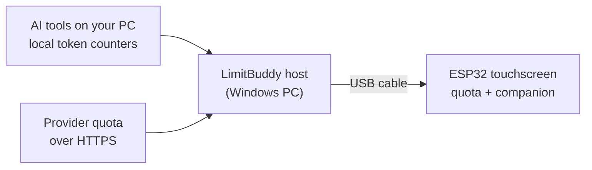
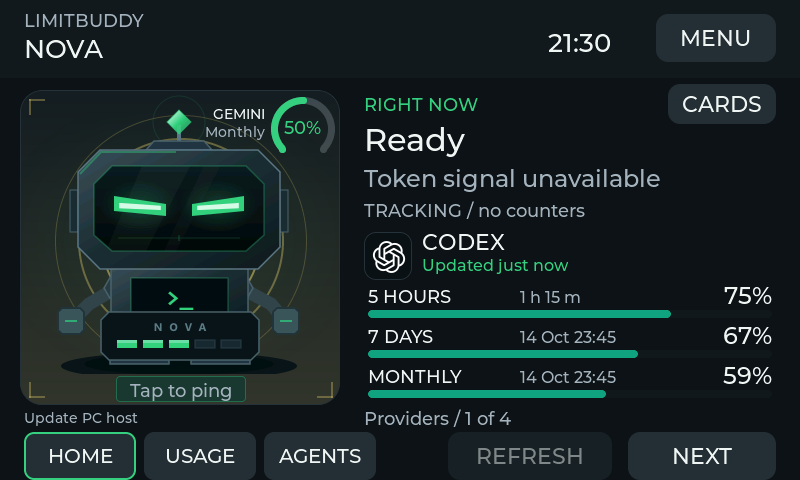
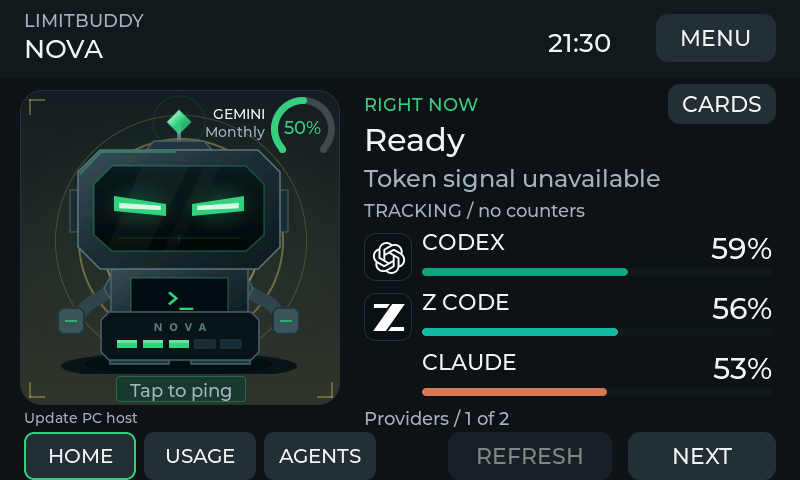
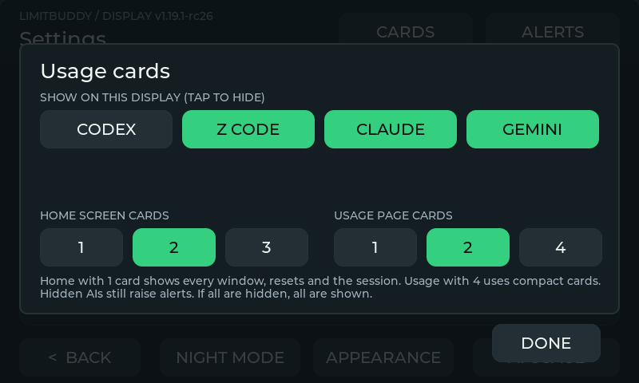
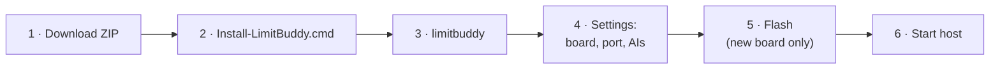

# LimitBuddy

**Your AI coding quota on a 4.3-inch ESP32 touchscreen beside the keyboard.** Session and weekly limits, reset countdowns and low-limit alerts for Claude Code, Codex, ZCode and more, plus an animated companion that reacts to your token activity. USB only: no Wi-Fi, no cloud relay, and your keys never leave the PC.


<p align="center">
  <a href="https://github.com/catorendal-a11y/limitbuddy/releases"></a>
  <a href="https://github.com/catorendal-a11y/limitbuddy/actions/workflows/ci.yml"></a>
  <a href="LICENSE"></a>
  <a href="https://github.com/catorendal-a11y/limitbuddy/stargazers"></a>
</p>

<p align="center">
  <b><a href="https://github.com/catorendal-a11y/limitbuddy/releases">Download</a></b> ·
  <a href="docs/QUICK_START.md">Quick Start</a> ·
  <a href="docs/PROVIDERS.md">Providers</a> ·
  <a href="docs/TERMINAL.md">Terminal guide</a> ·
  <a href="https://github.com/catorendal-a11y/limitbuddy/discussions/categories/q-a">Ask a question</a>
</p>

## How it works



The PC does the reading. The display only receives numbers over USB. LimitBuddy never sends prompts to a model and has no incoming network listener.

## Meet the companions

| NOVA | ORBIT | CLAUDE | WRAITH ¹ | GLITCH ¹ |
| :---: | :---: | :---: | :---: | :---: |
|  |  |  |  |  |

¹ ESP32-P4 only. Four colour themes: **Forest, Ocean, Amethyst, Ember**. The companion's ring shows your tightest quota window, and its tag shows **RUN / WAIT / FAULT / DONE**. Previews are UI renders with sample data.

## Read the display at a glance

| Provider cards | Needs you | Even-burn marker | 7-day history |
| :---: | :---: | :---: | :---: |
|  |  |  |  |

> [!TIP]
> The white marker shows where an even burn would be by now. If the "left" bar is shorter than the marker, you are using quota faster than the window allows. Amber and red edges mean the quota is low or critical. See [what each mark means](docs/QUICK_START.md#reading-the-display).

### Choose what you see

| One AI on home | Three AIs on home | CARDS settings |
| :---: | :---: | :---: |
|  |  |  |

Tap **CARDS** on the home screen to hide AIs and pick **1, 2 or 3** home cards. One card shows every window with its reset and the session. The USAGE page takes **1, 2 or 4** cards ([four compact cards](docs/ui/dashboard-four-cards.png)). Hidden AIs still raise alerts.

## Supported AI tools

| Tool | Activity | Quota (5 h / 7 d) | What you need |
| --- | :---: | :---: | --- |
| **Claude Code** | ✅ | ✅ | Be signed in to Claude Code on this PC ² |
| **Codex** | ✅ | ✅ | The official Codex CLI, signed in with ChatGPT |
| **ZCode / Z.AI** | ✅ | ✅ | Optional Z.AI coding-plan key (also shows monthly MCP calls) |
| **Gemini CLI**, **OpenCode** | ✅ | — | Nothing |
| **Copilot**, **Cursor**, **Antigravity** | ✅ | — | An [external numeric bridge](docs/PROVIDERS.md#external-numeric-bridge) |

² Claude Code desktop does not run the statusline, so LimitBuddy reads quota from Anthropic's undocumented `api/oauth/usage` endpoint using your existing login. It checks at most every 5 minutes, lets the Claude Code CLI renew the login when it expires, and never logs or stores the token. [Details](docs/PROVIDERS.md#claude-code).

## Install (Windows 10/11 x64)



1. Download the **terminal ZIP** from [Releases](https://github.com/catorendal-a11y/limitbuddy/releases) and extract it to a permanent folder (not `Program Files`).
2. Double-click **Install-LimitBuddy.cmd**. It needs no admin rights and no separate Python.
3. Open a **new** terminal and run `limitbuddy`.
4. Go to **Settings > Edit settings**, choose your board, USB port and AI tools, then save. No AI is preselected.
5. For a new board, go to **Device > Firmware > First installation** and type `FLASH`. Nothing is flashed automatically.
6. Go to **Settings > Start host**. It keeps running after you close the terminal.

> [!WARNING]
> The ZIP is not publisher-signed, so SmartScreen may warn you. Only continue for a download from this repository's Releases, and compare it with `SHA256SUMS.txt`. See [Windows trust](docs/WINDOWS_TRUST.md).


## Hardware

| Board | Status | Plug into |
| --- | --- | --- |
| **GUITION JC4880P433 ESP32-P4** | ✅ Supported | Espressif USB data port |
| **Waveshare ESP32-S3-Touch-LCD-4.3** (original, not B/C) | 🧪 Experimental | USB TO UART |

You also need a USB **data** cable. The ZIP includes both firmwares, so you don't need PlatformIO for normal use. See [board details](docs/BOARDS.md).

## Troubleshooting

| Symptom | Fix |
| --- | --- |
| `limitbuddy` not recognized | Open a **new** terminal after installing. |
| Display says **NO HOST** | Go to **Settings > Start host** and check the port. |
| No USB connection | Use a data cable, pick the right port, and close other serial tools. |
| Claude card says "check login" | The host renews the login with the Claude Code CLI automatically. If it persists, run `claude auth login` once. |
| Codex quota unavailable | Finish the official CLI sign-in in **Provider setup**. |
| Robot does not react | It follows token *increases*, and some tools save usage late. Check **Device > Check USB**. |
| Anything else | Use **History > Diagnostic export** (it contains no keys or conversations) and open an [issue](https://github.com/catorendal-a11y/limitbuddy/issues). |

## Privacy

- 🔒 Keys and logins stay on the PC. The display never sees them.
- 🚫 There are no model prompts, no incoming network listener and no automatic code updater.
- 📁 The optional Z.AI key is stored in git-ignored `tools/aim_host.json`, so keep that file private.

[Security policy](SECURITY.md) · [Security review](docs/SECURITY_REVIEW.md) · [GitHub safeguards](docs/GITHUB_SECURITY.md)

## Build from source

You need Python 3.10 or newer. On Windows, double-click **AI-Monitor.bat**. On Linux or macOS:

```sh
sh setup.sh
.venv/bin/python tools/aim_terminal.py
```

[Developer guide](docs/DEVELOPMENT.md) · [Contributing](CONTRIBUTING.md) · [Releasing](docs/RELEASING.md) · [Watch the video](https://www.youtube.com/watch?v=1JR9_E1lWDg) · [Show and tell](https://github.com/catorendal-a11y/limitbuddy/discussions/categories/show-and-tell)

---

<sub>MIT for project-owned code and original NOVA/ORBIT artwork. Drivers, dependencies, fonts and provider marks keep their own terms: [third-party notices](THIRD_PARTY_NOTICES.md), [NOVA/logo sources](assets/nova/SOURCES.md), [ORBIT](assets/orbit/SOURCES.md), [CLAUDE](assets/claude/SOURCES.md). Independent project, not endorsed by any AI provider. Formerly *AI Monitor P4*.</sub>
