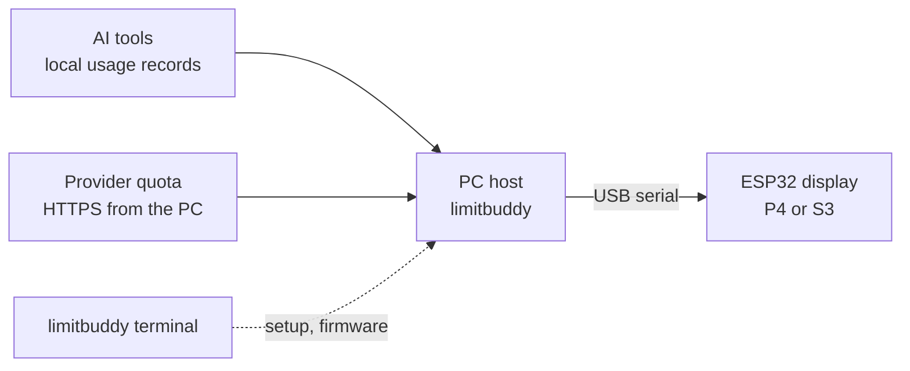

# LimitBuddy — ESP32 desk display for AI coding usage limits

**LimitBuddy** puts your AI coding quota on a 4.3-inch ESP32 touchscreen beside your keyboard: session and weekly limits, reset countdowns and low-limit alerts for **Claude Code, OpenAI Codex, Gemini CLI, Z.AI / ZCode, OpenCode, GitHub Copilot, Cursor and Antigravity**. An animated companion reacts to recorded token activity on your PC. USB only: no Wi-Fi, no cloud relay, keys stay on the PC.

*Formerly **AI Monitor P4** (`ai-monitor-p4-s3`); old links redirect here.*

> [!NOTE]
> Current candidate: **[v1.19.1-rc25](https://github.com/catorendal-a11y/limitbuddy/releases/tag/v1.19.1-rc25)** (prerelease). It adds a full-color terminal dashboard, direct device navigation, observed agent sessions, local-day history, companion packs, private diagnostics and [real USB device-screen capture](docs/DEVICE_MIRROR.md). Physical permission control stays disabled pending hardware/provider validation.


<p align="center">
  <a href="https://github.com/catorendal-a11y/limitbuddy/releases/tag/v1.19.1-rc25"></a>
  <a href="https://github.com/catorendal-a11y/limitbuddy/commits/main"></a>
  <a href="https://github.com/catorendal-a11y/limitbuddy/actions/workflows/ci.yml"></a>
  <a href="LICENSE"></a>
  <a href="https://github.com/catorendal-a11y/limitbuddy/stargazers"></a>
</p>
<p align="center">
  <a href="docs/BOARDS.md"></a>
  <a href="docs/BOARDS.md"></a>
  <a href="docs/BOARDS.md"></a>
  <a href="platformio.ini"></a>
  <a href="docs/DEVELOPMENT.md"></a>
</p>
<p align="center">
  <a href="docs/CODEX_SETUP.md"></a>
  <a href="docs/PROVIDERS.md#zcode"></a>
  <a href="docs/PROVIDERS.md#claude-code"></a>
  <a href="docs/PROVIDERS.md#gemini-cli"></a>
  <br>
  <a href="docs/PROVIDERS.md#external-numeric-bridge"></a>
  <a href="docs/PROVIDERS.md#external-numeric-bridge"></a>
  <a href="docs/PROVIDERS.md#external-numeric-bridge"></a>
  <a href="docs/PROVIDERS.md#external-numeric-bridge"></a>
</p>
<p align="center">
  <a href="#make-it-yours"></a>
  <a href="#make-it-yours"></a>
  <a href="#make-it-yours"></a>
  <a href="docs/QUICK_START.md"></a>
</p>
<p align="center">
  <a href="https://github.com/catorendal-a11y/limitbuddy/releases/tag/v1.19.1-rc25"></a>
  <a href="docs/QUICK_START.md"></a>
  <a href="docs/QUICK_START.md"></a>
  <a href="docs/DEVELOPMENT.md"></a>
</p>
<p align="center">
  <a href="docs/GITHUB_SECURITY.md"></a>
  <a href="docs/PROVIDERS.md#privacy-and-limits"></a>
  <a href="docs/GITHUB_SECURITY.md"></a>
</p>


*Quota needs the provider's supported account, key or bridge. Gemini, OpenCode and external numeric bridges report activity only. S3 is experimental.*

[](https://github.com/catorendal-a11y/limitbuddy)

**[Download LimitBuddy terminal](https://github.com/catorendal-a11y/limitbuddy/releases/tag/v1.19.1-rc25)** · [Quick Start](docs/QUICK_START.md) · [Provider setup](docs/PROVIDERS.md) · [Ask a question](https://github.com/catorendal-a11y/limitbuddy/discussions/categories/q-a)

## How it works



The host reads local token counters and queries quota; the display only receives numbers. No incoming network listener, no model prompts. See [Privacy and security](#privacy-and-security).

## Quick install (Windows x64)

1. Download the [terminal ZIP](https://github.com/catorendal-a11y/limitbuddy/releases/download/v1.19.1-rc25/nova-v1.19.1-rc25-windows-x64-terminal.zip) ([SHA-256](https://github.com/catorendal-a11y/limitbuddy/releases/download/v1.19.1-rc25/SHA256SUMS.txt)) and extract it into a permanent, writable folder (not `Program Files`).
2. Double-click **Install-LimitBuddy.cmd** once. It registers `limitbuddy` for your user; no admin rights, Python or extra downloads.
3. Open a **new** terminal and run `limitbuddy`.
4. **Settings > Edit settings**: choose board (P4 or S3), providers and USB port, then save. No AI is preselected; with several boards connected pick the explicit COM port.
5. New board? **Device > Firmware > First installation**, review board and port, type `FLASH` (resets display settings). Nothing is flashed automatically.
6. **Settings > Start host**. It keeps running after you close the terminal; switch on **Start at Windows sign-in** in Edit settings to survive restarts.
7. Optional: **Agents > Provider events** links Claude Code and/or Codex for the Agents screen and the "needs you" alert. Nothing is linked automatically.


Keys: **1-5** pages, **Tab/Enter** controls, **?** help, **Q** quit; use a 120 x 30 window or larger. More: [terminal guide](docs/TERMINAL.md), [PC requirements](docs/PC_REQUIREMENTS.md).

> [!WARNING]
> The ZIP is built by GitHub from this repository but is not publisher-signed. SmartScreen may warn: choose **More info > Run anyway** only for a download from this repository's Releases, and compare `SHA256SUMS.txt`. See [Windows trust](docs/WINDOWS_TRUST.md).

**Troubleshooting**

| Symptom | Fix |
| --- | --- |
| `limitbuddy` not recognized | Open a **new** terminal after the installer. |
| Display says **NO HOST** | **Settings > Start host**; check the port in Edit settings. |
| No USB connection | Use a data cable and the right port; close other serial tools. |
| Agents screen empty | Expected until providers are linked (step 7). |
| Robot does not react | Check observed status and **Settings / Recent host log**; **Device / Check USB**. |
| Anything else | **History > Diagnostic export** (no keys or conversations) for an [issue](https://github.com/catorendal-a11y/limitbuddy/issues). |

Upgrading, removing or Linux/macOS: [terminal guide](docs/TERMINAL.md#upgrade-and-migrate). GitHub's automatic **Source code (zip)** has no prebuilt firmware.

## What you need

| Display board | Status | USB connector |
| --- | --- | --- |
| **GUITION JC4880P433 ESP32-P4** | Supported | Espressif USB data port |
| **Original Waveshare ESP32-S3-Touch-LCD-4.3** | **Experimental; untested on physical S3** | **USB TO UART** (flashing and daily use) |

The S3 is the original CH422G model, **not B or C**. [Board details](docs/BOARDS.md). You also need a **USB data cable**, a **Windows 10/11 x64 PC** and your own AI account or CLI. The ZIP includes a private Python runtime and both boards' firmware; no PlatformIO or Arduino IDE for ordinary use.

## Meet your desk companion

| NOVA | ORBIT with the Ocean theme | CLAUDE with the Amethyst theme |
| --- | --- | --- |
|  |  |  |

| WRAITH (P4 only) | GLITCH (P4 only) | Choosing a companion |
| --- | --- | --- |
|  |  |  |

Sharp and a little menacing on purpose, not mascots. WRAITH and GLITCH are P4-only (the S3 has no flash left and shows NOVA instead). The figure shows a mood-coloured radar ring, a status tag (RUN / WAIT / FAULT / DONE), one chip per live session, a ring for the tightest quota window, and a standby tag when idle. Previews are LVGL renders with synthetic data, not photographs.

## Providers

Token activity and account quota are separate signals: a provider can animate the robot without reporting remaining quota.

| Provider | Token activity | Quota |
| --- | --- | --- |
| **Codex** | Local Codex database | Signed-in official Codex CLI (setup offers install/sign-in). |
| **ZCode** | Local ZCode database | Your optional Z.AI coding-plan key. |
| **Claude Code** | Local CLI usage records | Your Claude Code login (read-only, about every 5 minutes) or the optional statusline bridge. |
| **Gemini CLI** | Recorded local sessions | Activity only. |
| **OpenCode** | Local SQLite usage | Activity only. |
| **GitHub Copilot, Cursor, Antigravity** | External numeric bridge | Activity only; selecting them alone imports nothing. |

An **external bridge** supplies cumulative token counts. See [provider requirements](docs/PROVIDERS.md) and [Codex setup](docs/CODEX_SETUP.md); the monitor never asks for an OpenAI password or key.

> [!NOTE]
> **Claude quota needs no setup if you are signed in to Claude Code on this PC.** Claude Code desktop does not run the statusline command, and recent CLI versions no longer send `rate_limits` there. The host therefore reads your 5-hour and 7-day quota from Anthropic's undocumented `api/oauth/usage` endpoint, using the login in `~/.claude/.credentials.json` (`CLAUDE_CONFIG_DIR` is honoured). The token is read only inside the quota worker, never logged or stored; the endpoint is queried at most every 5 minutes, with backoff on HTTP 429. A fresh statusline reading wins. If the login expired, the Claude card shows "check login" until you use Claude Code again.

## Make it yours

On the display: **MENU > SETTINGS**.

| Where | What |
| --- | --- |
| **AI USAGE** | **< PREV / NEXT >** picks an AI and its quota window; **AUTO / MOST URGENT** follows the tightest; **REFRESH** requests a host update. Saved on the display; alerts still check every window. |
| **APPEARANCE** | Companion (NOVA, ORBIT, CLAUDE; P4 also WRAITH, GLITCH) and theme (**Forest, Ocean, Amethyst, Ember**). Applies immediately and is saved. |

Quota windows: **Codex** 5 HOURS / 7 DAYS. **ZCode** 5 HOURS / 7 DAYS model quotas when the plan supplies them, plus **MONTHLY MCP** (tool calls, not model tokens; [usage guide](https://zcode.z.ai/en/docs/usage-stats)). **Claude Code** 5 HOURS / 7 DAYS. **NOT REPORTED** never means unused: the companion shows unavailable until real data arrives.

| Codex window selection | ZCode window selection |
| --- | --- |
|  |  |

| Robot and color settings | Provider dashboard |
| --- | --- |
|  |  |

| ORBIT in Amethyst | NOVA in Ember |
| --- | --- |
|  |  |

**Read the display at a glance**

| Needs you | Even-burn marker | Tightest window | History |
| --- | --- | --- | --- |
|  |  |  |  |

The white marker on a bar is where an even burn would be by now: a "left" fill shorter than the marker means the quota is going faster than its window. Low or critical cards get an amber or red edge. [What each mark means](docs/QUICK_START.md#reading-the-display).

Also: reset countdowns, manual refresh, low/critical warnings ([larger alert preview](docs/ui/quota-critical-notification.png)), session history, brightness presets, idle dimming and night brightness. P4 dims with PWM; S3 dims the rendered image ([board differences](docs/BOARDS.md#brightness-and-performance)). [Provider details screen](docs/ui/details-ocean.png).

## If the robot is quiet

The robot follows **increases in recorded token counters**. The first sample is a baseline, and some clients save usage only when a request finishes, so activity can lag. This is an activity and quota display, not a billing ledger or per-token stream. Unsupported local formats stay unavailable; display history clears after a firmware restart.

| Symptom | First check |
| --- | --- |
| Codex quota unavailable | **Provider setup**: finish official CLI sign-in (needs a ChatGPT-backed login). |
| Claude card says "check login" | Open Claude Code once; the card recovers on the next query. |
| External provider inactive | Connect its numeric bridge. |

## Privacy and security

- The PC reads selected local usage sources, queries provider quota over HTTPS and sends display data over USB. No incoming network listener, no automatic code updater.
- For Claude, your existing login is used only to query quota; never logged or stored.
- Your optional Z.AI key is stored in plaintext in git-ignored `tools/aim_host.json`; keep it private. `ZAI_API_KEY` in the environment takes precedence; `.env` files are not loaded.
- GitHub Actions run on GitHub-hosted machines; no runner or webhook connects to the maintainer's PC. No maintainer credentials ship in source or releases.

[Security and private reporting](SECURITY.md) · [Host security review](docs/SECURITY_REVIEW.md) · [GitHub safeguards](docs/GITHUB_SECURITY.md)

## Watch the overview

[](https://www.youtube.com/watch?v=1JR9_E1lWDg)

[Two-minute video](https://www.youtube.com/watch?v=1JR9_E1lWDg) with subtitles (earlier companions and the retired graphical PC app; current releases use the terminal). UI previews use synthetic data.

## Run from source or contribute

Built one? [Show and tell](https://github.com/catorendal-a11y/limitbuddy/discussions/categories/show-and-tell) · [Q&A](https://github.com/catorendal-a11y/limitbuddy/discussions/categories/q-a) · [Ideas](https://github.com/catorendal-a11y/limitbuddy/discussions/categories/ideas) · [Report a bug](https://github.com/catorendal-a11y/limitbuddy/issues/new/choose). Keep keys, account data and private logs out of posts. A GitHub star helps others find the project.

Source needs **Python 3.10+**. Windows: double-click **AI-Monitor.bat**. Linux/macOS:

```sh
sh setup.sh
.venv/bin/python tools/aim_terminal.py
```

[Developer guide](docs/DEVELOPMENT.md) · [Release guide](docs/RELEASING.md) · [Contributing](CONTRIBUTING.md) · [Provider roadmap](docs/PROVIDER_ROADMAP.md) · [All releases](https://github.com/catorendal-a11y/limitbuddy/releases)

The graphical Windows app and EXE distribution are retired; see the [migration notes](docs/TERMINAL.md#upgrade-and-migrate).

Project-owned code and original NOVA/ORBIT artwork use [MIT](LICENSE). Drivers, dependencies, fonts and provider marks keep their own terms: [third-party notices](THIRD_PARTY_NOTICES.md), [NOVA/logo sources](assets/nova/SOURCES.md), [ORBIT artwork](assets/orbit/SOURCES.md). Independent project, not endorsed by its AI providers.
