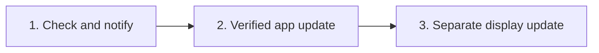

# Application updates, USB firmware updates and beginner setup

Research date: 2026-10-11. Status: **design proposal, not an implemented updater.** This does not authorize downloading or executing an installer, changing repository permissions or flashing a display.

> [!NOTE]
> Packaging changed after this research: the Qt app and Inno installer are retired. Releases are a Windows x64 terminal ZIP with a bundled Python runtime, installed by `Install-LimitBuddy.cmd` ([RELEASING.md](RELEASING.md), [WINDOWS_TRUST.md](WINDOWS_TRUST.md)). Verification, release-source, redirect, firmware and provider guidance still applies. Installer, `CloseApplications` and GUI-shutdown notes were dropped; a ZIP flow needs a new design (extract to a new folder, re-register commands, migrate settings) before any updater exists.

There is no Wi-Fi OTA. Installing the app and updating the display stay separate, explicit actions. The existing **Firmware > Install / update firmware** flow already writes bundled, verified firmware over USB.

## Current state

| Area | Today | Gap |
| --- | --- | --- |
| Package | ZIP bundles runtime, wheels, source, packs, both board images, internal `SHA256SUMS.txt` (`scripts/build_terminal_release.py`, `test_terminal_package.py`) | Local hashes do not authenticate a downloaded publisher; nothing is Authenticode-signed |
| Upgrade | `Install-LimitBuddy.cmd` registers `limitbuddy`/`nova` for the current user; uninstall keeps `tools/aim_host.json` | A new version is a new folder; no settings migration or host-stop coordination |
| Firmware | `tools/desktop_support.py` + `tools/aim_control.py` verify files; user reviews board, operation, port and types `FLASH`; revalidated after confirmation; only the owned host stops; flasher bounded and reaped | A remote firmware package needs the same release authentication. First install resets display settings; a non-booting update fails the identity probe |
| Providers | No AI preselected; Codex install/sign-in action; ZCode masked quota key; Claude confirmed link action | Selection installs nothing, creates no account or entitlement |

## Rollout

1. **Check and notify:** manual **Check for updates**, later an opt-in background check. Shows current and offered version and plain-text notes plus **Open official release**. Launches nothing; offline or rate-limited checks never stop the host.
2. **Verified application update** (only after signing/provenance and upgrade-recovery prerequisites): **Download verified update**, then **Install and reopen**. A check is not consent to install.
3. **USB display update:** compare the display's version to the installed bundle; offer **Update display** through the existing board/port review and `FLASH` confirmation. Never flash because the app updated or a device appeared.

Current unsigned releases should stop at stage 1; never lower a future verification requirement.

## Release source and download rules

| Rule | Requirement |
| --- | --- |
| Source | Compiled constant `catorendal-a11y/limitbuddy`; no user-supplied feed, URL, command, plugin or script |
| Metadata | Public GitHub latest-release REST endpoint, no token. Accept only strict stable `vMAJOR.MINOR.PATCH`, no draft/prerelease; compare numerically with the running and highest accepted version; reject downgrades and unexpected asset names. `target_commitish` is not a verified SHA |
| Assets | Exactly `nova-v<version>-windows-x64-terminal.zip`, `SHA256SUMS.txt` and a bounded provenance bundle; matching tag, version, platform and asset ID. Notes shown as inert plain text |
| Polling | ETag and conditional requests, honor rate-limit headers; proposed default one background check per day, bounded sizes, explicit connect/read/total deadlines |
| Redirects | Validate each: HTTPS only, no URL credentials, no IP literal or local target, bounded count, exact approved hosts such as `release-assets.githubusercontent.com`; never broaden to `*.githubusercontent.com`. Tie file to validated asset ID, size and hash; a changed delivery host fails until reviewed |
| Staging | Fresh per-user directory, fixed local filename, size cap, streamed SHA-256, atomic rename after verification; paths never derived from release text |
| Privacy | Sends no keys, config, token records, logs or machine IDs; no inbound listener |

Docs: [latest release](https://docs.github.com/en/rest/releases/releases#get-the-latest-release), [REST best practices](https://docs.github.com/en/rest/using-the-rest-api/best-practices-for-using-the-rest-api), [release assets](https://docs.github.com/en/rest/releases/assets#get-a-release-asset).

## Integrity, provenance, publisher

| Check | Establishes | Does not establish |
| --- | --- | --- |
| SHA-256 and byte count | Bytes match the accepted expectation | Publisher or account not compromised |
| Verified build/release provenance | Artifact bound to expected repository, source identity and workflow | Source audited or malware-free |
| Trusted Authenticode signature | Windows-validated chain and approved publisher | SmartScreen reputation; safety if the publisher is compromised |

- Compare the release `digest` (`sha256:<64 hex>`) with the computed hash and manifest; missing or mismatched data blocks verified install. A `SHA256SUMS.txt` from the same mutable release is integrity evidence, not a trust anchor.
- Prefer immutable releases ([docs](https://docs.github.com/en/code-security/concepts/supply-chain-security/immutable-releases), [verification](https://docs.github.com/en/code-security/how-tos/secure-your-supply-chain/secure-your-dependencies/verify-release-integrity)); do not assume old releases are immutable.
- Attestations: require the exact repository, release workflow, source ref/tag and digest; reject self-hosted provenance; do not trust workflow-controlled predicate text as signer identity ([policy](https://cli.github.com/manual/gh_attestation_verify)).
- Beginners must not need GitHub CLI or login: bundle a verifier or ship a public key with detached signatures, and ship trust roots. Offline verification has root-rotation/revocation limits to handle ([docs](https://docs.github.com/en/actions/how-tos/secure-your-work/use-artifact-attestations/verify-attestations-offline)). Never run a freshly downloaded unsigned verifier to judge another download.
- Authenticode via the Windows trust API ([WinVerifyTrust](https://learn.microsoft.com/en-us/windows/win32/api/wintrust/nf-wintrust-winverifytrust)) with a reviewed publisher policy, timestamp/revocation handling and a rotation plan; any-trusted-publisher is too broad. Revalidate hash/publisher immediately before launch. Certificate-status lookups must never become feed or download sources; if forbidden, use a cache-only policy and block verified install when revocation evidence is missing.
- Since v1.18.5 the workflow attests the ZIP and `SHA256SUMS.txt` in its isolated publisher after checksum verification; this is not an in-app verifier. See [GITHUB_SECURITY.md](GITHUB_SECURITY.md).

## Install, interruption, firmware

- ZIP flow needs: extraction to a new version folder, command re-registration, scoped host stop/restart only if that owned host was running, no duplicate instance, private config backup and schema compatibility. Launch with fixed argument lists, never a shell string from remote metadata; no forced-close or silent shortcuts. Cancellation leaves the old app usable; rollback after settings migration needs a reviewed procedure.
- Portable and installed layouts stay separate; a first updater supports one and gives a guide for the other; later portable updates need bounded extraction, path/symlink checks, atomic version-directory switch and reviewed settings migration.
- App installation never touches device NVS. An application-only flash preserves settings only if the project identity and partition layout validate; factory demo, other project or wrong board never enter that path. Verify board/chip and all hashes, require a newer compatible version, show the exact COM port.
- First installation writes the factory layout and resets display settings; keep that visible and never use it as a silent fallback. After an interrupted flash, offer first-install recovery with explicit reset consent. A settings-preserving recovery is future work. S3 is experimental until validated on the original CH422G board; B/C variants unsupported.

## Provider onboarding limits

| Provider | Supported path | Cannot be done silently |
| --- | --- | --- |
| Codex | **Install / sign in Codex** (official standalone CLI) or reuse existing | Account, browser sign-in, vendor confirmation; subscription quota needs ChatGPT-backed access, API billing differs |
| ZCode | Local token activity needs no key; **Enter Z.AI key** (masked, optional) | Install/sign in, own coding-plan key; a key is not proof of quota |
| Claude Code | Local activity reader; confirmed **Link Claude quota**; OAuth usage fallback ([review](SECURITY_REVIEW.md)) | Client sign-in, restart, custom statusline conflicts; windows may be absent |
| Gemini CLI, OpenCode | Local session / SQLite numeric readers | Client setup; no remaining-quota adapter |
| Copilot, Cursor, Antigravity | Numeric ingestion bridge | Selection alone imports no editor activity; no personal-quota adapter |

Quota choices list only provider-reported windows. Keep **Not configured**, **Activity available**, **Quota pending**, **Quota received**, **Quota unavailable** and **Bridge required** distinct; token counts, context, remaining percentage and billing differ. See [CODEX_SETUP.md](CODEX_SETUP.md), [PROVIDERS.md](PROVIDERS.md), [PROVIDER_ROADMAP.md](PROVIDER_ROADMAP.md).

## Signing decision

Signing is needed for a dependable publisher gate but does not guarantee SmartScreen approval; EV no longer bypasses reputation, and a consistent identity matters ([reputation](https://learn.microsoft.com/en-us/windows/apps/package-and-deploy/smartscreen-reputation)). Never disable Defender/SmartScreen, strip security marks, ask users to install a project root certificate or call an unsigned file Microsoft-approved. Evaluate an open-source signing program, a CA certificate or a Microsoft route, checking eligibility (restrictions apply, e.g. for a Norwegian individual); MSIX/Store is a separate project ([options](https://learn.microsoft.com/en-us/windows/apps/package-and-deploy/code-signing-options)).

## Acceptance before shipping an updater

- Synthetic tests reject wrong repository, unexpected redirects, downgrade/replay, malformed metadata, duplicate assets, missing provenance, wrong publisher, digest/size mismatch and files changed before launch; no failure starts an installer or flasher.
- Offline/429/timeouts leave host and private files untouched; checks are cancellable and coalesce clicks.
- Disposable Windows tests cover fresh install, upgrade, cancellation, failed replacement and recovery on the final signed bytes. Physical P4 confirms post-flash version and NVS preservation (S3 outstanding). A PC update never auto-flashes.

Until these pass, use the reviewed release ZIP plus the explicit USB firmware workflow.
