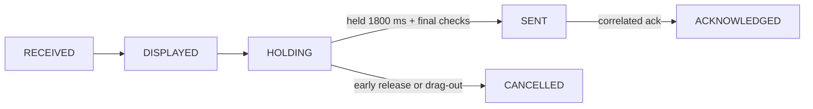

# Claude live protocol foundation

> [!NOTE]
> Retained reference and tested code, not the production v2 architecture; it must not gain new product dependencies. Production activity comes from normalized hooks over USB; permission control uses a dedicated helper, same-user IPC and generic interaction models. See [COMPANION_V2](../plans/COMPANION_V2.md).

`src/live_agent/` is independent of USB/AIM1 quota snapshots, provider readers, companion rendering, LVGL and BLE. It is synthetic/native only: it cannot run commands, approve a tool call, open a model session or modify Claude configuration.

## Input and freshness

| Rule | Value |
| --- | --- |
| Input | Bounded UTF-8 JSON lines, max 4,095 bytes |
| Fragment deadline | 5 s; overflow discards the rest of the line |
| Disconnect / reconnect | Clears buffer / new epoch |
| Lease | 30 s, renewed only by a valid snapshot (commands and turn events do not extend it) |
| Counts | total/running/waiting up to 1,024; optional unsigned 64-bit output-token counters (activity, not input tokens, quota or billing) |
| Not retained or logged | Summary, transcript entries, owner info, completed-turn content |

**Permission prompt:** exactly three fields: ID (96 ASCII identifier chars), tool (64 UTF-8 bytes), hint (512 UTF-8 bytes, newlines allowed). No truncation. NUL, unsupported control characters, malformed input, missing or extra fields fail closed. Unsupported glyphs stay nonapprovable, and the UI must confirm full details are visible.

Prompt identity covers the complete original ID/tool/hint bytes. Changed details, an omitted prompt, expiry, invalid input or disconnect invalidate approval context; sanitization cannot merge two requests.

## Permission state

`PermissionMachine` (`src/interaction/permission_state.h`, aliased from `src/live_agent/permission_state.h`) defines NONE, RECEIVED, DISPLAYED, HOLDING, SENT, ACKNOWLEDGED, DENIED, EXPIRED, CANCELLED and ERROR. Happy path:

- Display confirmation needs matching epoch/revision and an explicit `completeDetailsVisible` from the UI. Early release, drag-out or touch failure must call `cancel_gesture`; navigation cancels.
- The final decision rechecks prompt, lease, local opt-in and secure link, and is returned once. The transport adapter revalidates right before TX; failed or ambiguous sends are never retried as an approval.
- Opt-in and security parameters are trusted local state, never remote JSON fields.
- The Desktop reference specifies no permission acknowledgement, so delivery or prompt disappearance is not ACKNOWLEDGED. A correlated-ack hook exists for a documented source; no protocol integration uses it yet.

## Tests and gates

`scripts/run_tests.py` builds and runs `tests/test_claude_live.cpp` with strict warnings: fragmented/oversized/stalled input, malformed snapshots, changed prompts, reconnect, clock rollover, stale leases, unsupported text, visibility, early release, single-use decisions, final opt-in/security/identity checks.

Native LVGL permission controls, pointer cancellation, commit checks and persistent interaction authority are implemented ([PERMISSION_UI](PERMISSION_UI.md)). Still open: physical touch testing, synchronized firmware publication, a verified USB/provider adapter. No permission sender is enabled in production ([USB-only integration](USB_LIVE_TRANSPORT.md)).

Bluetooth is permanently excluded. Direct Hardware Buddy integration was removed because its [documented transport](https://github.com/anthropics/claude-desktop-buddy/blob/main/REFERENCE.md) is BLE (an experimental Claude Desktop developer-mode interface); USB cannot replace it.
