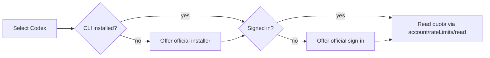

# Automatic Codex setup

No Codex CLI needed in advance. NOVA installs the official client if missing, reuses an existing one, and offers official browser sign-in. No provider is preselected.

## Steps

1. Extract the Windows x64 terminal ZIP, run **Install-LimitBuddy.cmd**, open a new terminal, type `limitbuddy`.
2. **Settings > Edit settings**: select board, USB port and Codex; save.
3. **Agents > Codex sign-in** (Codex setup action). If the CLI is missing, accept **Install the official Codex CLI now?** (declining is fine; finish later).
4. If needed, accept **official Codex sign-in** and finish the vendor flow with your own ChatGPT account. LimitBuddy never asks for or copies your password or token.
5. Back in **Settings**, start the host. **Overview** shows quota status.

> [!NOTE]
> A found CLI or running process does not prove quota is available. Your selection stays saved if install or login fails or is skipped; retry via the same Agents action.

## PC requirements

| Item | Detail |
| --- | --- |
| Windows | x64. Windows 11 recommended; updated Windows 10 best effort (1809+ for modern console) |
| Runtime | Included: Python, pinned libraries, both boards' firmware. No Python, Qt, PlatformIO or Arduino IDE needed |
| Codex CLI | Downloaded after approval; compatible installs reused |
| Node.js / npm / Git | Not needed (an npm-based CLI uses its own Node) |
| PowerShell | Runs the official installer; managed-PC policy may block it |
| Internet, browser | For download and sign-in; installing NOVA from the ZIP is offline |
| Account | Your ChatGPT account with Codex access; no OpenAI API key for subscription quota |
| USB | Data-capable cable; no COM port means check cable and driver |

Per-user install, no admin rights. Source archives need Python 3.10+ (`.venv`); firmware builds need the [developer tools](DEVELOPMENT.md). Linux/macOS source installs use the documented shell installer. LimitBuddy only reads status: no coding tasks, no sandbox. No credentials ship with the release. See [PC requirements](PC_REQUIREMENTS.md), [CLI install](https://learn.chatgpt.com/docs/cli), [Windows support](https://learn.chatgpt.com/docs/windows/windows-sandbox).

## Accounts and storage

- The CLI keeps its credential store (file or keyring); setup never rewrites global Codex config or moves storage to plaintext. `CODEX_HOME` and `CODEX_INSTALL_DIR` honored. Login status output is not logged.
- **Quota:** CLI app-server `account/rateLimits/read`. No model turn, code generation, credit-reset redemption or email. Without a CLI, an existing file-login adapter is a legacy fallback (never copied into project config).
- **Tokens:** numeric SQLite counter under `CODEX_HOME`.
- Needs a ChatGPT-backed account; API-key-only gives no subscription quota; ephemeral credentials may fail across processes. Missing data shows unavailable. Change account or storage with the official CLI.

## Troubleshooting

| State | Action |
| --- | --- |
| CLI missing | Agents > Codex setup action, accept install |
| Not found after install | Restart the app (PATH), retry |
| Sign-in skipped or cancelled | Run the setup action again |
| Quota unavailable | Check ChatGPT sign-in; update the CLI if its account interface is unsupported |
| Tokens unavailable | Use sessions that update the local numeric DB; registration may lag |
| Another provider selected | Codex setup not run; see [Providers](PROVIDERS.md) |

USB settings, providers, Z.AI key and theme are independent of Codex login; a failed step enables no extra AI.

## Lifecycle events (optional)

**Agents > Provider events**, choose Codex, leave Remove off, type `LINK`; trust the hooks in Codex's `/hooks` browser and restart the session. Remove preserves other hooks. A saved config does not prove delivery; support depends on client version. See [Live provider events](LIVE_PROVIDER_EVENTS.md).

## Verification

Synthetic tests cover install/sign-in prompts, declined setup, login reuse, discovery and read-only account requests. `scripts/test_codex_windows_install.py --disposable-ci` installs the real client on a disposable GitHub Windows runner (isolated state, no Node/Python on PATH), checks discovery and login status, then declines sign-in.

> [!WARNING]
> Never run the disposable-CI test on a personal PC: the vendor installer can change your user PATH. It does not prove login for every account.

References: [authentication](https://learn.chatgpt.com/docs/auth), [rate limits](https://learn.chatgpt.com/docs/app-server), [environment](https://learn.chatgpt.com/docs/config-file/environment-variables).
