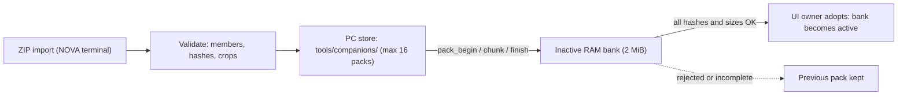

# Companion animation format 2

All built-in companions share one allocation-free animation player above `CompanionRenderer` and the verified P4 LZ4 cache (sequences in `src/companions/builtin_animation.h`).

- Working/attention/success/error select several existing poses; resting/warning/critical stay stable poses.
- Each mood has its own timing and loop policy. Success is non-looping and holds its last frame.
- Changing companion or mood restarts the clip.
- Testing animation comes only from a fresh explicit TESTING event for a selected provider. Token increases never imply testing, success or other phases.

## Schema

| Field / limit | Value |
| --- | --- |
| Version, pixels, codec | exactly 2; RGB565A8; raw or LZ4 |
| Manifest size | <= 8,192 bytes |
| Assets / moods / steps per sequence | <= 16 unique / <= 8 distinct / <= 16 |
| Step | existing asset ID, 40-60,000 ms |
| Loop, fallback | explicit boolean loop; required fallback mood with a real sequence |
| Crop / origin | one global union across all frames, inside the 430x284 canvas |
| Integrity | exact encoded and decoded SHA-256, encoded-byte limits, decoded size = width x height x 3 |
| Names | safe lowercase filenames; no traversal or reserved device names; unknown/duplicate fields rejected |
| Top-level fields | version, name, format, codec, fallback, frames, animations |
| Moods | resting, working, testing, attention, success, error, warning, critical |

`frames` lists each asset: `id`, `file`, size/origin, encoded/decoded byte counts, both hashes.

```json
{"mood":"working","loop":true,"frames":[
  {"id":"work_1","durationMs":150},
  {"id":"work_2","durationMs":150},
  {"id":"work_3","durationMs":150}
]}
```

Only a complete valid manifest is published. Playback handles clock rollover, skipped ticks and one-shot completion with no allocation, decoding or transport access; asset ownership, pins, hashes and raw fallback stay in the renderer/cache.

## External packs on P4



1. In the NOVA terminal open **4 Device > Companion packs**, choose **Import and use pack**, type `IMPORT`.
2. The ZIP must hold `manifest.json` and exactly its declared frame files, plus optional `LICENSE` and `README.md`. Archives are never extracted or executed. Duplicate members/fields, unsafe names, unknown files, oversize data, invalid crops, timings, hashes or compressed blocks are rejected before selection.
3. **Use built-in companion** restores normal rendering. **Remove unused pack** cannot remove the selected pack or the user's original import file.

| Item | Detail |
| --- | --- |
| Durable store | PC `tools/companions/` (original archive/notices + verified content-addressed payload); git-ignored, excluded from release exports; host restores the selected pack after display restart |
| Display | current pack in RAM only; no display filesystem formatting, NVS image storage or microSD |
| P4 startup reservation | two 2 MiB encoded banks + one bounded frame-validation buffer (~4.35 MiB PSRAM, separate from the decoded frame cache) |
| Activation | staging never overwrites the active bank; UI owner detaches the old LVGL/cache binding before switching |
| Failure | allocation failure leaves built-in rendering available |

- Transfers use bounded `pack_*` commands through the existing serial owner, with boot ID, random transaction nonce, exact offsets, receipts and timeout.
- A complete transfer is not active until the UI owner adopts it. Failed or incomplete replacements keep the previous companion.
- Pressing a built-in companion on the display overrides the pack; the host reports the override rather than reinstalling. Restore the pack from the desktop selection.
- S3 does not advertise external runtime support.

## Export original example packs

```text
python scripts/build_companion_packages.py --output work/companion-packs
```

Exports only NOVA and ORBIT (`--output` is the sole option) from committed original pixels and timings, pinned LZ4 compression, exact hashes and the unchanged MIT notice. No provider logos, no trademark rights. Native tests are not physical rendering evidence.
