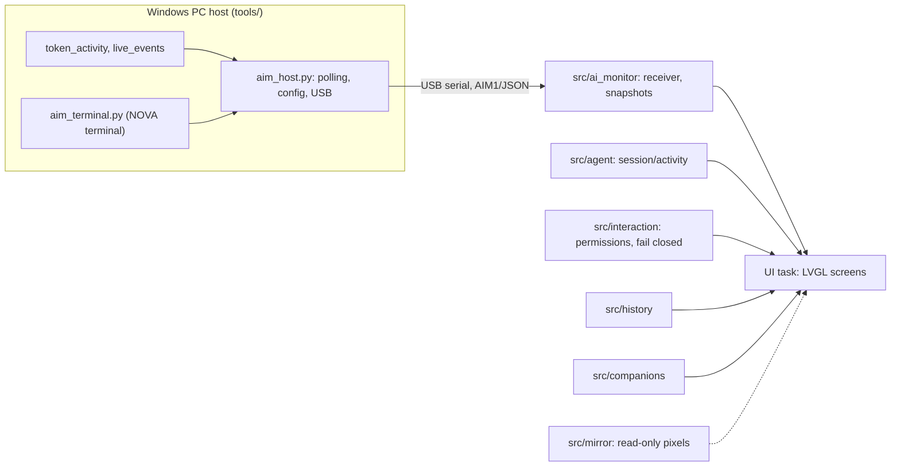

# Developer guide

USB desk display for AI usage limits and locally observed token activity. Targets: **GUITION JC4880P433 ESP32-P4** and an experimental **original Waveshare ESP32-S3-Touch-LCD-4.3** ([boards](BOARDS.md)). A Python host reads quota and local activity ([providers](PROVIDERS.md)); the firmware displays it and stores no cloud credentials. Code, comments, UI and docs are English.

> [!NOTE]
> Current distribution is the terminal app: run `Install-LimitBuddy.ps1` once, then `limitbuddy`. The graphical app and EXE build are retired. Build source/firmware ZIPs with `scripts/build_terminal_release.py` ([RELEASING.md](RELEASING.md)). The current candidate is `FW_VERSION` in `src/config.h` (also read by `tools/project_version.py`); validation boundaries are in [v2 status](V2_STATUS.md).

## Architecture



One serial owner per device. Per-module rules live in [AGENTS.md](../AGENTS.md).

## Features

Five companions (NOVA, ORBIT, CLAUDE, WRAITH, GLITCH; the last two P4 only) with working, ready, celebration, low-quota, resting and connection states; dashboard, provider details, reset countdowns, refresh; session-local 1 / 6 / 24 h history with gaps; configurable low/critical alerts; backlight presets, idle dimming, night schedule, persistent settings; USB heartbeat, reconnect, last-valid data and rate-limit backoff; token-source tracking with signal-loss feedback.

## Build environments

| | P4 | S3 (experimental) |
| --- | --- | --- |
| PlatformIO env | `esp32p4-release` | `esp32s3-waveshare-43-release` |
| Platform pin | pioarduino P4 `55.03.312-1`, commit `2959e98a2750832bca32fd2f849c0c274a4cdd63` | pioarduino `54.03.20`, commit `c6f1f4164d16dae8fda13221eb0f2722429175c6`; Arduino 3.2.0 + Espressif's matching high-performance SDK |
| Display / touch | ST7701S 480x800 MIPI-DSI (LVGL 800x480 landscape), GT911 on GPIO 7/8, backlight PWM GPIO 23 | native RGB, GT911, CH422G; UART0 on GPIO44/43 |
| Memory | 16 MB flash, 32 MB PSRAM | 8 MB OPI PSRAM with PSRAM XIP |
| Upload | USB | USB TO UART port |

Shared pins ([platformio.ini](../platformio.ini)): LVGL `v9.6.0` (commit `80ca777e37a2b176770726a02e07a6fb79ef0b39`), ArduinoJson `7.4.3`. Python 3.10+. First build needs internet. Other boards need their display init and pins reviewed.

- PlatformIO core, Python env and SDKs live in the ignored `.pio/core`, isolated from global installs.
- Build P4 and S3 **sequentially**, collecting each image pair first (different shared Arduino SDKs). See [local release builds](RELEASING.md#local-build-on-windows).
- Native tests cover protocol/UI under both board profiles; drivers still need a physical board.
- The 32 KiB Arduino startup stack covers display/touch/USB init; after setup `loop()` unregisters its watchdog and deletes its task. UI and USB tasks keep their watchdogs. Do not shrink the startup stack without measuring high-water on both boards.

## Windows quick start

```powershell
powershell -NoProfile -ExecutionPolicy Bypass -File .\setup.ps1 -BuildTools
.\.venv\Scripts\python.exe -m platformio run -e esp32p4-release
```

`setup.ps1` creates `.venv`; `-BuildTools` adds PlatformIO. It copies the credential-free example to `tools/aim_host.json` only if absent, and never flashes or starts the host.

> [!WARNING]
> Stop the companion before flashing, and flash only the identified port.

```powershell
.\.venv\Scripts\python.exe -m platformio device list
.\.venv\Scripts\python.exe -m platformio run -e esp32p4-release -t upload --upload-port COM6
```

Output is in `.pio/build-fw/esp32p4-release/`: `fw_*.bin` (app) and `fw_*.factory.bin` (adds bootloader and partitions); upload picks the right one. For S3 swap the environment (`python -m platformio run -e esp32s3-waveshare-43-release`).

Start the host: `.\.venv\Scripts\python.exe tools/aim_host.py`, or `tools/start-aim-host.bat` (background launcher: prefers this checkout's `.venv`, then PlatformIO's Python, then PATH; checks pyserial; restarts only hosts running this exact script; log in `tools/aim_host.log`). Stop the background host via Task Manager by matching its command line to this checkout's `tools/aim_host.py`.

## Linux / macOS

```sh
sh setup.sh
.venv/bin/python -m pip install "platformio>=6.1,<7"
.venv/bin/python -m platformio run -e esp32p4-release
.venv/bin/python -m platformio device list
.venv/bin/python -m platformio run -e esp32p4-release -t upload --upload-port /dev/ttyACM0
.venv/bin/python tools/aim_host.py
```

Serial permissions are OS-specific; the background launcher is Windows-only.

## Configuration

Template: [tools/aim_host.example.json](../tools/aim_host.example.json). The host loads `tools/aim_host.json` and creates defaults if absent.

| Setting | Meaning |
| --- | --- |
| `board` | `guition-p4` or `waveshare-s3-43`; empty until first setup (older configs keep P4). |
| `port` | `auto` connects only if exactly one candidate port exists for the board; otherwise set explicitly (host logs candidates and waits). |
| `interval_s` | API interval 15-240 s, default 240; valid edits apply while running. |
| `zai_provider` | Keep `zcode`. |
| `zai_key` | Optional local credential, empty in the example. Prefer env `ZAI_API_KEY` (takes precedence). |

- Codex quota: official CLI account RPC (starts no model turns). Without a CLI, a legacy read-only `auth.json` fallback under `CODEX_HOME` or `~/.codex`; never copied or modified.
- Z.AI needs your own coding-plan credential. The host does **not** load `.env` files (`.env.example` only documents the variable).
- No credentials are needed to build or test. Local config, auth, env files, databases, logs and build output are git-ignored; never put real credentials in examples, issues or screenshots.
- Unsupported responses produce an error, not invented values. Independent project, not an official integration.

## What the companion measures

It follows **increases in local numeric token counters**, independent of keyboard, mouse or touch.

| Source | Counter |
| --- | --- |
| Codex | `threads.tokens_used` in `~/.codex/state_5.sqlite` (read-only SQLite) |
| ZCode | `model_usage.computed_total_tokens` in `~/.zcode/cli/db/db.sqlite` (read-only SQLite) |
| Claude / Gemini | selected local log records parsed for usage counters and record IDs; no conversation text retained, logged or exported |

- Polled every ~2 s (also during API requests). Existing totals are a baseline, not new activity.
- TRACKING names readable sources, not which app caused the last increase. Caption shows time since last increase; large counts use K/M/B (one decimal); the USB info response keeps the exact count. Unavailable or stale signals are shown explicitly; quota cards separate in-progress updates from stale measurements.
- Up to 16,384 recent IDs per source; a bounded tombstone filter baselines retired IDs that reappear (a collision may drop a first increment, never invents one). Caches are session-local; schema changes may need adapter updates.

| Budget | Value |
| --- | --- |
| Quota helper request / full cycle | 25 s / 45 s (allowlisted helper, credentials via stdin only) |
| Local token polling | 2-15 s |
| Firmware signal-age allowance | 35 s |

- Timeout cleanup reaps the helper and descendants before the next request; USB heartbeats continue meanwhile. USB host loss invalidates the signal immediately.
- One coalesced local-count worker does DB/file reads apart from the USB owner: a blocked read cannot delay heartbeats or spawn threads, its old signal expires, provider changes discard old results; it keeps numeric records only and never sends frames.
- Observed consumption outranks NOVA's low-quota expression (bars and banners still show limits). After 90 s without an increase NOVA celebrates then becomes ready; after 5 min it may rest. Dimming, missing or stale signals do not prove rest.

> [!NOTE]
> Registration can lag generation until a request reports usage. This is not per-token streaming, billing, proof of completed work, or an account-wide total. Missing/incompatible databases cannot establish activity. Numeric diagnostics in the USB info response separate counter detection from quota polling.

## Screen behavior

NOVA is the default view; **MENU** reaches HOME / USAGE, SETTINGS and HISTORY (Today/24h/7d from the PC database); tap a provider card for details (prev/next, swipe). **REFRESH** on the home screen requests an API round and shows waiting, progress and result; minimum intervals and backoff still apply. Details: [device navigation](DEVICE_NAVIGATION.md).

On-device history keeps valid samples in 5-minute buckets for up to 24 h since boot (cleared on restart; failed/stale data adds none). Dismissed LOW/CRITICAL alerts rearm after recovery with hysteresis. Night schedule uses host time; settings are local NVS.

## Verification

Python tests use fakes and temporary databases (no device or credentials):

```powershell
.\.venv\Scripts\python.exe -m pip install -r scripts/requirements-test.txt
.\.venv\Scripts\python.exe -m unittest discover -s tests -p "test_*.py"
```

After a firmware build fetches ArduinoJson/LVGL, native tests need a C++17 compiler; UI tests also need GCC, CMake and Ninja:

```powershell
.\.venv\Scripts\python.exe scripts/run_tests.py
.\.venv\Scripts\python.exe scripts/run_tests.py --ui --screenshots work/ui-previews
```

`--cxx` / `--cc` set compiler paths; use `.venv/bin/python` on Linux/macOS. UI tests write PPM screenshots with mock hardware; touch and flashing need the board. CI runs Python, release firmware and native tests without credentials.

## Troubleshooting

| Symptom | Fix |
| --- | --- |
| No connection | Close serial monitors, pick the right port, use a data cable; several Espressif devices need an explicit port. |
| No token reaction | Check the app updates the supported database; allow time for usage registration; inspect numeric diagnostics. Quota fetching alone is not consumption. |
| API errors | Check CLI login / local Z.AI credential; share only redacted status text, never auth files. |
| Upload cannot open port | Stop the companion and other serial clients. |
| Odd brightness | SET shows selected/actual brightness and NORMAL / NIGHT / IDLE; check schedule and idle timeout. |

## Assets, licensing, contributions

Project code and original NOVA art: [MIT](../LICENSE). Drivers, dependencies, fonts and provider marks keep their own terms ([THIRD_PARTY_NOTICES.md](../THIRD_PARTY_NOTICES.md), [asset sources](../assets/nova/SOURCES.md)); logos do not imply endorsement.

Generated firmware assets are committed, so Node.js is optional. To regenerate: install Node.js and `sharp` in an isolated environment, run `node scripts/generate_nova_assets.cjs`, preserve logo geometry and notices. See [CONTRIBUTING.md](../CONTRIBUTING.md) and [SECURITY.md](../SECURITY.md).
