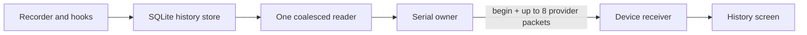

# Today and device history

**MENU > HISTORY**, pick a provider: tokens today, its latest observed model quota window, and a graph of 24 hourly buckets or seven local days. BACK and the period button stay fixed; dropdown option identities cannot change while open.

## Data flow

- Enable **local usage history** in the PC app's Host settings (off by default). The existing PC SQLite DB is the only store; the display gets bounded numeric summaries, never a database, prompt or transcript.
- Reader uses a hard SQLite deadline. Each packet stays under AIM1's 4095 bytes. The receiver publishes only complete transactions, keeps old data on a failed/expired transfer and clears the view when history is disabled. History has its own snapshot and cannot affect quota, token activity, live agents or permission authority.
- Protocol 2 adds a bounded `agents` summary per provider; schema 3 adds nullable created/started/completed/failed task counters. Schemas 1-2 still accepted; the host sends only supported fields.

## Reading the screen

- Grey gaps = no observation, never zero. Today uses the PC's local midnight (23 or 25 h on DST days); future buckets excluded. Samples older than 2 min are not sent and feed the stale marker.
- The quota line names its exact model window. Percentage-point change appears only across the same window, reset and recorder epoch. Tool/MCP quotas never mix with model quotas. Observation history, not billing, forecast or task progress.

| Metric | Requires | Notes |
| --- | --- | --- |
| Sessions | SessionStart | |
| Turns | Prompt start plus matching Stop/StopFailure | Not tasks. Interruption or session end closes activity without inventing counts. Outcome belongs to the day of the terminal event |
| Active time | Observed intervals | Waiting excluded; gaps over 15 min unknown; concurrent activity unioned; not total work time |

Unavailable metrics show `--`. Live session timers are a separate source ([Live agent view](LIVE_AGENT_VIEW.md)).

## Event journal and consent

Opt-in, same SQLite backend: fixed Codex/Claude/ZCode lifecycle events with hashed session identities. Schema 1 migrates transactionally to 2 without touching token/quota records. No prompt, tool arguments, output or permission hint.

| Limit | Value |
| --- | --- |
| Journal cap | 50,000 events / 30 days (recorder housekeeping also prunes old agent/task rows) |
| Hook write lock timeout | 20 ms |
| Recorder lease | 90 s, renewed every 30 s; abandoned permission expires within 90 s of a crash |

> [!IMPORTANT]
> Normal host stop and disabling history revoke write consent; a source event cannot extend the lease. Saves, revocation and history transactions share a bounded process lock. A persistent revocation floor stops older recorders renewing a revoked epoch (even on rapid disable/enable). Workers check saved policy before minting or committing.

## PC History tab and CSV

Daily summary (7 or 30 local days): sessions, active seconds, completed and failed turns. An event exactly at midnight belongs to the next day; a known interval ending there can close the previous day's active time. Changing provider clears the summary and disables export until loaded.

CSV includes these metrics even with no token/quota sample; lifecycle dates use `local_date`, quota timestamps stay UTC; unknown metrics are omitted, not zero. Zero failed turns means real completed/failed evidence without failures, not task success.

## Client-reported task outcomes

- Claude Code counts creation from a successful TaskCreate `PostToolUse`. TaskUpdate counts a start/completion only when `success` is exactly true, input/response task IDs agree and `statusChange` confirms a real transition. Verified on Claude Code 2.1.296 with an isolated task and TaskGet readback; other shapes fail closed. TaskGet alone cannot date an old completion; pre-veto hooks and failed updates never count. Counts are distinct tasks per local day.
- Bounded `task_events` table: hashed task/session/tool-call identities, generation, consent epoch, fixed event, timestamp; same 50,000/30-day cap, write deadline and revocation checks. No subjects, descriptions, arguments or output are stored or sent.
- Identity uses the effective Claude config root (`CLAUDE_CONFIG_DIR`, honored by setup, link status/removal and readers; explicit test homes stay isolated) plus task-list ID (`CLAUDE_CODE_TASK_LIST_ID`, else session ID). Shared lists dedupe across sessions. Rc8 uses versioned hashes; mixed legacy/new identities in one daily metric make it unknown, single-kind metrics count normally.
- Failed-task counts stay unknown (the TaskUpdate contract reports no failure), as do Codex/ZCode task outcomes until a supported confirmed interface exists. "Complete" from a client does not prove builds or tests passed.
- Custom model IDs such as GLM may need `CLAUDE_CODE_ENABLE_TODO_TOOLS=1` in the Claude environment to expose task tools; no file/shell permission or physical approval is granted. [Task tools](https://code.claude.com/docs/en/tools-reference#task-tool-availability), [hook decisions](https://code.claude.com/docs/en/hooks#taskcompleted).

Synthetic tests cover local-day boundaries, gaps, overflow, invalid schema, future timestamps, selection changes, receipt correlation, atomic transfer/replay/expiry and real LVGL layout.
