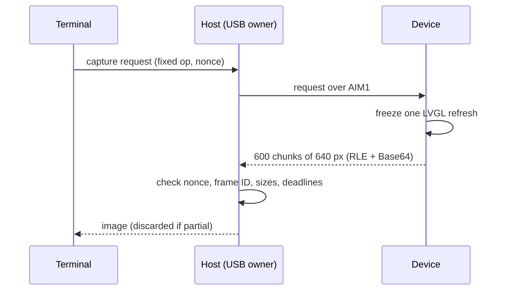

# Real device screen over USB

In the terminal, open **Device > Device screen**. The running host stays the only USB serial owner. The result is a read-only, single snapshot of the actual 800x480 RGB565 pixels the device rendered (normal overlays included), scaled to colored half-block cells. It is not live video, a simulation or a generated preview; opening it starts no polling. Choose **Device screen** again for a fresh capture.

## Transfer

- P4 pixels are captured before its manual portrait rotation; S3 pixels before its panel write.
- 600 correlated chunks of 640 pixels, bounded RGB565 little-endian RLE plus Base64, worst-case payload under AIM1's 4,095 bytes.
- Nonce, device frame ID, dimensions, chunk index, decoded lengths and deadlines must all match; partial or inconsistent images are discarded.
- Quota, token and live metadata stay separate.

## Memory and limits

| Item | Value |
| --- | --- |
| PSRAM during capture | 768,000 image bytes + 48,000 coverage bytes, scrubbed and released on completion, expiry, disconnect or protected screen |
| Allocation | Only on request; failure reports unavailable and the normal UI keeps running |
| Image lease | 30 s idle, 120 s absolute |
| PC mailbox | Current user only; fixed capture operation, no caller path, network endpoint, shell command or virtual touch |
| Responses | Bounded, nonce-matched, removed after display/cancel, expire after 60 s |

> [!IMPORTANT]
> Enrollment/code-comparison and permission screens are excluded and scrubbed; the viewer cannot substitute for physical security confirmation. Captures never enter usage history or Git.

Native tests exercise the pinned LVGL partial RGB565 compositor and top layer, incomplete refreshes, overlap coverage, worst-case chunks, strict inputs, replay, expiry and protected screens. PC tests cover decoding/correlation, storage isolation, cancellation and host scheduling without provider or model requests. Hardware transfer timing is recorded in V2_VALIDATION.md.
