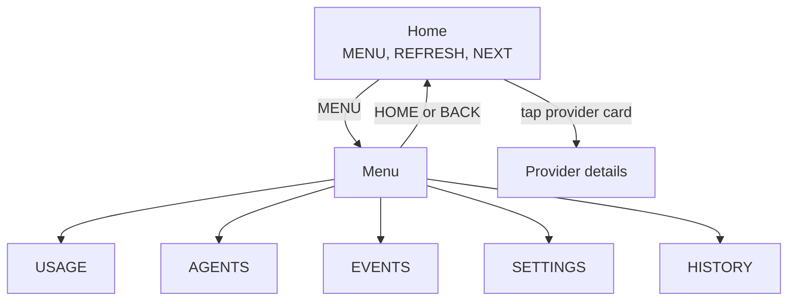

# Device navigation and readability

The 800 x 480 UI uses one MENU entry for navigation and secondary actions.

BACK returns to the calling screen (Settings does too when closed). Quota popups are suppressed while navigating the menu without dismissing the underlying alert.

| Screen | Behavior |
| --- | --- |
| **Home** | MENU and a large, fixed REFRESH. Refresh is disabled when the host is disconnected, lacks manual refresh or is updating, and is rechecked on activation. NEXT appears only with more providers; hiding it moves no other control. |
| **Menu** | HOME, USAGE, AGENTS, EVENTS, SETTINGS, HISTORY as 92-pixel targets; 56-pixel BACK. |
| **Usage** | Always two full-size provider cards per page (also with 3-8 providers). The old four-card grid and redundant home/update buttons are gone. Provider identity is kept until touch release, even if data or order changes. |
| **History** | Compact Today / 24h / 7d view. |
| **Settings** | Two 56-pixel dropdowns with 26-pixel text replace eight brightness/dimming choices; brightness slider and test-dimming remain. Choices and persistence are unchanged. |

## Text sizes

| Element | Size (px) |
| --- | --- |
| Home status | 24-32 |
| Percentages | 40 |
| Provider names / status | 22 / 20 |
| Agent names / states / timers | 26 / 24 / 20 |
| Notification headings / details | 24 / 20 |

Detailed telemetry may keep smaller secondary text. The menu works in all four palettes. Native LVGL tests cover fixed geometry, navigation and return paths, refresh gating, settings persistence, dropdowns, provider rebinding and touch/dimming/permission regressions on P4 and S3 profiles. Images are synthetic native previews, not hardware photographs.
