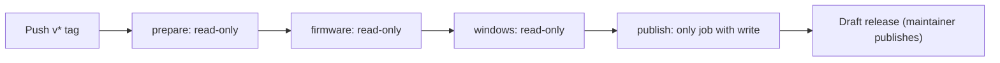

# GitHub security

Public source does not give a reader access to the maintainer's PC. Readers can copy code and propose pull requests but cannot push without write permission. The monitor never auto-pulls or executes code from GitHub. Review a contribution before running or merging it.

## Repository controls (verified 2026-10-09)

| Area | Setting |
| --- | --- |
| Access | Owner is the only account with write/admin. No deploy keys, webhooks or self-hosted runners. Actions secrets and variables empty. Builds run on GitHub-hosted Ubuntu/Windows |
| Workflow token | Default read-only; cannot approve pull requests. All external contributor workflows need maintainer approval (read the code **and** workflow diff first: approval runs code on a runner) |
| Actions | Only `actions` org: checkout, setup-python, upload-artifact, download-artifact, attest-build-provenance. Full commit SHA pinning required. Checkouts keep no Git credentials |
| Branches/tags | Main deletion and force push blocked. Existing `v*` tags cannot be moved or deleted; only administrators create version tags |
| Scanning | Secret scanning, push protection, private vulnerability reporting, Dependabot security updates on; CI checks dependency advisories. Local keys/config, CLI auth, logs, databases excluded from Git and release exports |
| Immutability | On for future releases: published assets and tag lock. v1.12.0/v1.12.1 predate it (tags protected by rules). Never replace published assets; ship a new reviewed version |

> [!WARNING]
> Nothing here protects against takeover of the owner's GitHub account. Keep two-factor or a passkey, keep recovery methods private, review newly authorized apps/tokens. Two-factor status was not verifiable through the API connection. A checksum fetched from a compromised account authenticates nothing.

## Release permissions

| Job | Permission | Notes |
| --- | --- | --- |
| prepare | contents: read | Skips the build if a release for the tag exists, so a reviewed release is never overwritten |
| firmware, windows | contents: read | Build and test only |
| publish | contents, id-token, attestations: write; actions: read | Downloads this run's artifact, verifies the ZIP against `SHA256SUMS.txt`, attests ZIP and checksum file, `gh release create --verify-tag --draft`. Does not check out or execute repository code, install dependencies or run generated executables |

Verify a download: `gh attestation verify <file> --repo catorendal-a11y/limitbuddy`. This proves GitHub workflow provenance, not Authenticode publisher signing or safe source. See [attestation guidance](https://docs.github.com/en/actions/security-for-github-actions/using-artifact-attestations/using-artifact-attestations-to-establish-provenance-for-builds) and [RELEASING.md](RELEASING.md).

## No path back to the maintainer's PC

The reviewed monitor has no inbound listener, tunnel, remote-control endpoint, automatic GitHub update or GitHub-to-PC runner/webhook.

| Surface | Boundary |
| --- | --- |
| Internet | Fixed allowlist `PROVIDER_ENDPOINTS` (`tools/host_security.py`), verified HTTPS, redirects rejected ([review](SECURITY_REVIEW.md)) |
| USB panel | Serial data, not keyboard input; no Wi-Fi/OTA or USB HID. Only a valid refresh event queues a quota update; nothing installs, flashes, executes or reads a requested file |
| Quota worker | Allowlisted numeric-only child process. Z.AI key arrives on stdin, never in arguments; the Claude worker reads its local login itself (no stdin credential). Timed-out workers and descendants are reaped before retry. Accepts no model-turn, firmware or command requests. Ownership checks use the actual script/executable entry point, not a path anywhere in a command line |
| Retired v1.18.1 desktop handoff | Used a per-installation `QLockFile` and `QLocalServer` (**UserAccessOption**, current-user named pipe, no TCP) accepting only bounded `show`/`firmware` window commands; no credentials, files or settings. [Qt docs](https://doc.qt.io/qt-6/qlocalserver.html#SocketOption-enum) |

Synthetic security tests feed execution/install/download/flash/file commands into USB replies, command-like fields into API quota data, execution notifications into Codex's account RPC and path/command fields into telemetry. None may dispatch processes, expose keys in panel data or write outside the numeric telemetry folder. The database reader is also checked against an extension-loading view; SQLite extension loading is not enabled. Source launchers use the absolute system PowerShell path. Zero listening sockets were recorded in the v1.18.1 check.

Policy tests check pinned Actions, disabled checkout credential persistence, GitHub-hosted runners, the isolated write-permission job, draft-only tag-verified publishing, and absence of privileged pull-request triggers or named secrets (`scripts/requirements-test.txt`). Review the server settings independently if the repository is copied to another owner.

> [!IMPORTANT]
> No backdoor was identified, but this is not proof that every dependency or the whole PC is unexploitable. Outside the guarantee: a modified local program, code deliberately installed or merged by the owner, account takeover, installed malware. The optional Codex install is user-requested trusted software and ordinary polling never invokes it. Do not run unreviewed pull requests on the PC or add a self-hosted runner.

Sources: [Actions policy and fork approval](https://docs.github.com/en/repositories/managing-your-repositorys-settings-and-features/enabling-features-for-your-repository/managing-github-actions-settings-for-a-repository), [immutable releases](https://docs.github.com/en/code-security/concepts/supply-chain-security/immutable-releases), [future-only immutability](https://docs.github.com/en/code-security/how-tos/secure-your-supply-chain/establish-provenance-and-integrity/prevent-release-changes).
