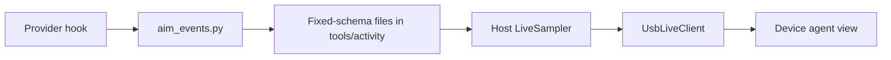

# Local live provider events

Opt-in Codex, Claude Code and ZCode lifecycle observers feed the USB live domain. Source-level integration with synthetic validation; normal P4 USB operation is physically verified, but real client delivery remains a separate gate. Quota and token sources are independent. Device screen: [Live agent view](LIVE_AGENT_VIEW.md).

## Data flow

## Setup

Save the selected provider, then in AI setup choose **Link Codex / Claude / ZCode session events** (**Agents > Provider events**, leave Remove off, type `LINK`). A private backup is kept and existing hooks are preserved. Removing the link removes only this installation's exact hook commands and invalidates its observation generation.

Console: `--link-events codex|claude|zcode` and `--unlink-events ...`; the provider must already be selected.

| Provider | Mechanism | Notes |
| --- | --- | --- |
| Codex | Effective `CODEX_HOME/hooks.json`, documented lifecycle hooks ([docs](https://learn.chatgpt.com/docs/hooks)) | Review and trust hooks in `/hooks` before they run; changed definitions need review again. Never bypass trust. Restart the session. Shell wrapper returns only neutral `{}` JSON, even on observer failure, because Stop/SubagentStop expect JSON. |
| Claude Code | Explicit observational hooks; `--claude-event` is the hook command, `--link-events claude` installs it ([docs](https://code.claude.com/docs/en/hooks)) | Hooks never return approval, denial, rewritten input, model context or continuation. Restart Claude Code. |
| ZCode | Documented user-level process hooks ([docs](https://zcode.z.ai/en/docs/hooks)) | Only its seven documented events accepted; no per-subagent coverage. Existing global disablement preserved; confirm Hooks is enabled, start a new session. |

> [!IMPORTANT]
> A saved link is not proof of delivery. Installed-client compatibility and genuine hook delivery remain validation gates. No provider API calls and no new model turns; the helper emits no content. Other providers have no live observer yet.

## State mapping

| Reported event | Display state |
| --- | --- |
| SessionStart | IDLE |
| UserPromptSubmit, unclassified tool use, PostToolUse | WORKING (no guessed detailed phase) |
| PermissionRequest, supported Claude attention notification | WAITING |
| Codex apply_patch; Claude Edit/MultiEdit | EDITING |
| Claude Write / Read / WebFetch | WRITING / READING |
| Claude Bash / PowerShell | RUNNING (command text not inspected) |
| Claude Grep/Glob/WebSearch | SEARCHING |
| Stop/SubagentStop | COMPLETED: response/agent ended, not proof a build or task succeeded |
| Claude StopFailure / PostToolUseFailure | ERROR (interrupted tool failure becomes IDLE) |
| Claude PermissionDenied | NEEDS_ATTENTION (auto-mode denial observation, never an approval/retry) |
| Claude TeammateIdle | IDLE for that teammate, parent preserved |
| Claude TaskCreated / TaskCompleted | TASK_CREATE_REQUESTED / TASK_COMPLETE_REQUESTED: bounded request metadata, not confirmed success |
| Codex Interrupt | IDLE |
| SessionEnd | Remove the parent session entry |

- Shell commands are never inspected to guess BUILDING/TESTING. THINKING is never inferred from token increases or missing tool events. UNKNOWN = phase not reported.
- Subagent start/stop use separately hashed identities; tool attribution is unavailable when a hook identifies only the parent. ZCode shares the prompt/tool/permission/stop mapping but reports no subagents.
- Claude task hooks run before other handlers can veto, so they never increment confirmed task counts or replace the parent phase. Titles and descriptions are discarded.

## Timing

A UserPromptSubmit or SubagentStart starts a timer; tool events keep that start. Stop/SubagentStop/StopFailure/Interrupt/SessionEnd/TeammateIdle freeze a known timer; a new prompt starts a new one. Without an observed start the UI says start unknown. No token-derived start or inferred progress. Durations are capped at seven days and wall-clock rollback is rejected. Same-provider updates use a bounded local file lock so concurrent hooks cannot overwrite a newer event. No network listener, no new dependency.

## Stored data and freshness

Stored: SHA-256 actor identity, fixed state, observation time, optional observed start/finish times, schema, setup generation. Discarded: prompts, commands, messages, tool results, transcript paths. Records are the latest received observation, not a heartbeat or execution log.

| Rule | Value |
| --- | --- |
| Ongoing observations expire | 15 min |
| Terminal/idle states expire | 30 s |
| NOVA reacts only to sources no older than | 30 s (a fresh USB packet never renews source time) |
| Excluded | Closed, stale, future-dated, invalid records |
| Worker samples cleared after | 10 s |
| Device lease after USB loss | 30 s |
| Agents sent | At most 8; waiting/failure first; not a total count |

## Transport

An independent event worker reads only selected, enabled sources with bounded scans. Metadata never enters token commands or quota snapshots. Host health exports only the live transport's fixed status, timestamp and acknowledged count, with no identities or content. The serial owner negotiates live support, correlates replies and keeps quota monitoring if live telemetry times out; serial I/O errors still reach the reconnect handler. Firmware advertises `liveMetadata: 2`; the host sends elapsed/last-observed seconds only to that capability and downgrades state names and drops timing for older firmware. The PC's Agent USB status distinguishes acknowledged delivery, expired samples and errors; an acknowledged empty snapshot confirms transport, not a genuine client event.

## Diagnostic checkpoint (historical, October 2026)

A read-only `hooks/list` RPC showed all ten Codex user hooks trusted and enabled, and the neutral wrapper ran in 250 ms. A later audit found no observer records from a running process. A fresh inventory does not prove a running conversation delivers events. No trust, permissions, transcripts or sessions were modified. See [Agent integration audit](AGENT_INTEGRATION_AUDIT.md).
