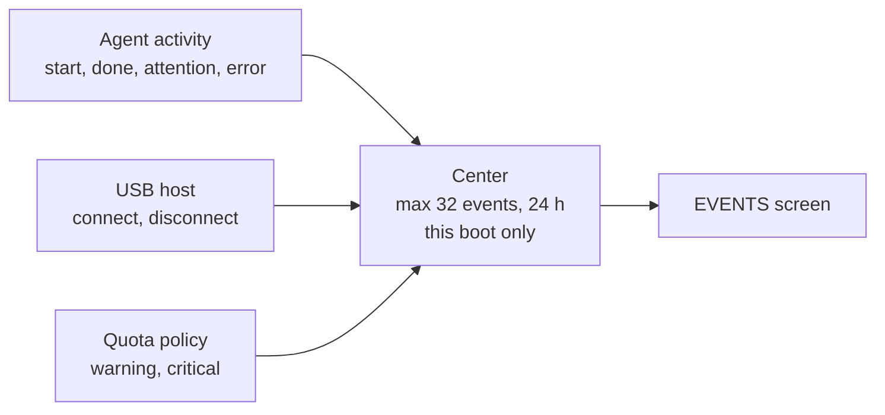

# Device notification center

Open **MENU > EVENTS**. The summary shows the unread count. The center has four fixed rows per page, NEXT PAGE when needed, BACK and READ ALL.

> [!NOTE]
> Reading notifications never approves a tool, dismisses a provider permission or runs a command.

## What it stores

- Fixed event type, provider/source, rollover-safe local time and read flag, shown as relative age and ordered by event time.
- Fixed English text only. No prompts, hints, tool arguments, paths, credentials or transcripts; nothing is persisted.
- Missing actors never become completion events; repeated unchanged states are deduplicated; only source observations no older than 30 seconds create agent events.

## Limits

- It observes normalized snapshot transitions, not a full PC event journal, so very short transitions between host samples can be missing.
- COMPLETED means a reported response/agent ended, not that a task, build or test succeeded. Structured task requests live on the PC and create no success notifications here.
- Permission decisions, companion-pack failures and storage/build integrations are not event sources yet.
- Quota popups stay independent: the center hides the popup while visible, and marking an entry read does not acknowledge or suppress future warnings. It works in all four palettes without moving controls.

Native tests cover bounded storage, repeated snapshots, disconnect, terminal/attention events, expiry/rollover, paging, empty data, read marking, stable controls and themes. Physical USB/boot/memory checks go in V2_VALIDATION.md after flashing.

The preview uses synthetic events, not a photograph or real account activity.
