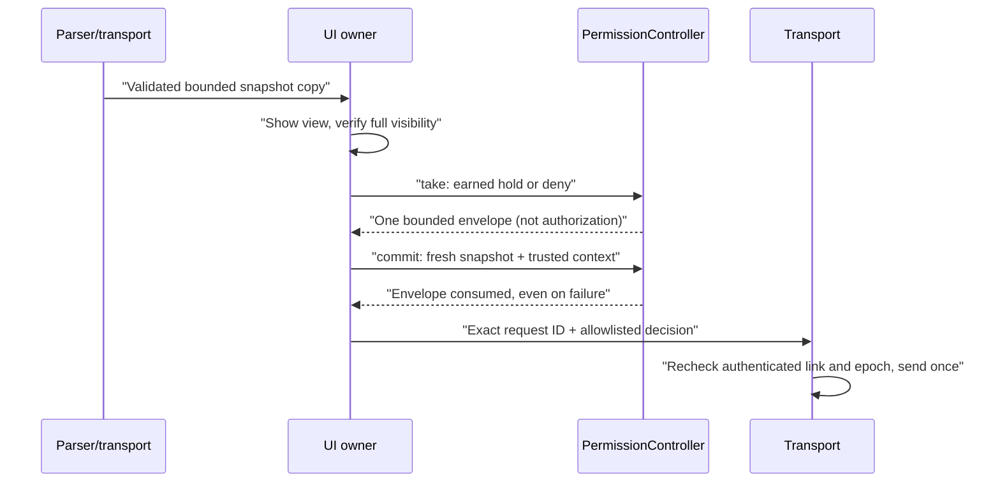

# Live permission UI prototype

> [!WARNING]
> The dialog is implemented and tested with native LVGL pointer input but is **not initialized in production firmware** and has no production permission sender. Bluetooth is permanently excluded.

Synthetic request; not evidence of a paired device or real tool approval.

## Interaction contract

`PermissionView` has fixed DENY and HOLD TO APPROVE targets, request identity, tool, full bounded hint and hold progress.

| Input | Result |
| --- | --- |
| Continuous 1,800 ms hold with fresh successful pointer samples in the same target | Approves |
| CLICKED, keyboard activation, short tap, long-press notification | Never approves |
| Drag-out, release, failed touch read, navigation, stale data, changed ID or details, disconnect, opt-out, sleep, demo mode | Cancels |
| Fixed CLOSE | Cancels queue/commit authority (also for unreviewable requests); sends no decision |

- Every detail must fit and stay visible. Unsupported glyphs or overflow make the request nonapprovable; review it on Desktop.
- A popup above the dialog, system overlay, hidden field, opacity change or clipped/moved dialog also blocks the final send gate. Labels are compared with the full canonical request, not a displayed prefix. Buttons keep their coordinates through state and text changes.

## Authority and final send

`PermissionController` is independent of LVGL, parser and transport and must outlive its view, so recreating widgets cannot reset the consumed-request ledger. Only trusted local connection/security/settings/display state creates `PermissionContext`; all flags default closed and JSON cannot assert trust, opt-in or authentication.

Rules for the adapter:

1. Share only synchronized copies with the UI thread; never retain or log transcripts or hints in history/export.
2. Use the parser's monotonic millisecond clock; verify full visibility before DISPLAYED and before pointer input.
3. The envelope alone never authorizes sending; `commit` rechecks visibility/text, issued identity, lease, security and state.
4. Serialize only the request ID and decision, not tool/hint. Failed or ambiguous delivery enters ERROR and is never retried. No delayed queue may bypass the final gate or use stale values.

A successful write is not an acknowledgement: the archived [Hardware Buddy reference](https://github.com/anthropics/claude-desktop-buddy/blob/main/REFERENCE.md) defines no correlated permission ACK, so ACKNOWLEDGED stays reserved for a documented trusted source and is never invented.

## Validation and gates

- Controller tests: incomplete display, interrupted holds, prompt/epoch/security checks, expiry, one-time consumption, cancellation after handoff.
- Native P4/S3 pointer/visibility tests: valid hold, denial, short tap, touch failure, drag-out, changed IDs/details, disconnect, expiry, unsupported/long text, demo, sleep/opt-out, overlays, navigation, hidden/faded/clipped/altered text; fixed controls; view recreation cannot repeat an approval.
- These do not establish physical touch reliability or real provider behavior.

> [!IMPORTANT]
> A production adapter needs independently verified host trust, a documented provider decision interface, explicit local opt-in, synchronized publication, bounded TX/RX and physical disconnect tests. Default: no permission transmission.

Plan: separate helper `tools/aim_permission.py` (the events hook never gains authority), same-user IPC, existing USB host; generic interaction types replace the old ClaudeLiveSnapshot dependency. Path and status: [USB_PERMISSION_HELPER.md](USB_PERMISSION_HELPER.md), [USB_INTERACTION_AUTH.md](USB_INTERACTION_AUTH.md), [USB_LIVE_TRANSPORT.md](USB_LIVE_TRANSPORT.md), [phase 7](../plans/COMPANION_V2.md).
