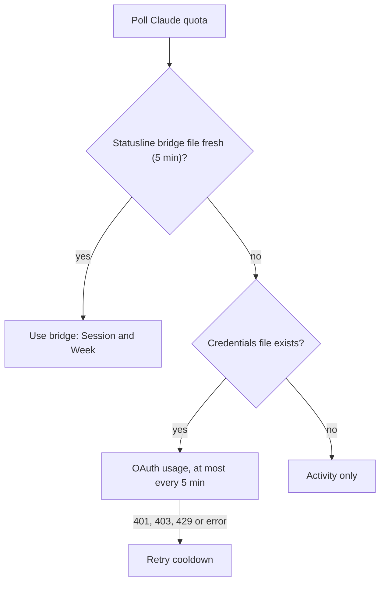

# Choose your AI providers

Setup check, live test and history: [Usage insights](USAGE_INSIGHTS.md).

> [!IMPORTANT]
> No AI is preselected. Open **Settings > Edit settings** in NOVA and select providers explicitly. Unselected providers are never polled or scanned, and a missing API key never changes your selection. New configs contain `"providers": []`; older configs keep their Codex/ZCode choice.

## Comparison

| Provider | Activity source (local, automatic) | Quota source | Setup |
| --- | --- | --- | --- |
| Codex | Numeric counters in the local Codex SQLite DB | Official CLI account interface; legacy file fallback | Select Codex; offers CLI install/sign-in ([guide](CODEX_SETUP.md)) |
| ZCode | Numeric request counters in the local ZCode SQLite DB | Z.AI coding-plan adapter | Select ZCode; optional coding-plan key |
| Claude Code | `message.usage` fields in CLI JSONL transcripts (deduplicated by message ID) | Statusline bridge, else undocumented OAuth usage | Select Claude; **Agents > Claude quota link** |
| Gemini CLI | `tokens.total` from recorded CLI sessions | None | Select; use with session recording |
| OpenCode | Numeric SQLite message/session projections | None | Select; no key or script needed |
| GitHub Copilot | [Numeric bridge](#external-numeric-bridge) | None | Forward events from your Copilot SDK app |
| Cursor | Numeric bridge | None (Admin API is team-only) | Supply cumulative token telemetry |
| Antigravity | Numeric bridge | None | Supply numeric telemetry |

- **Agents > Check AI setup** lists readable sources and next steps. It sends no model request and no USB write. Selecting a provider does not prove its source is readable.
- With no real quota percentage, NOVA shows **LOCAL / Activity only**. It never substitutes context occupancy, request counts, billing estimates or invented percentages.
- Optional lifecycle events (Codex, Claude Code, ZCode only): [Live provider events](LIVE_PROVIDER_EVENTS.md).

## ZCode

**Quota (optional).** Get your own **GLM Coding Plan API key** ([instructions](https://docs.z.ai/devpack/quick-start)), select ZCode, paste it into the masked field and save. LimitBuddy never recovers ZCode's login or asks for your Z.AI password. A blank key means activity only; a saved key is kept unless replaced or cleared.

| Window | Shown as | Provider field |
| --- | --- | --- |
| Model, hours | **5 HOURS** | `CREDIT_LIMIT` / `TOKENS_LIMIT`, `unit=3`, normally `number=5` |
| Model, weeks | **7 DAYS** | same, `unit=6`, normally `number=1` |
| Monthly MCP tool allowance | **MONTHLY MCP** | `TIME_LIMIT` |

A monthly subscription payment is not a monthly token budget. **SET > AI USAGE** explains the windows, shows each remaining percentage and saves the selected window. Missing windows stay unavailable.

**Live phases (optional).** **Agents > Provider events**, choose ZCode, leave Remove off, type `LINK`; enable Hooks in ZCode and start a new session. Details: [Live provider events](LIVE_PROVIDER_EVENTS.md).

References: [usage stats](https://zcode.z.ai/en/docs/usage-stats), [Coding Plan rules](https://docs.z.ai/devpack/overview), [usage-query script](https://github.com/zai-org/zai-coding-plugins/blob/main/plugins/glm-plan-usage/skills/usage-query-skill/scripts/query-usage.mjs), [hooks](https://zcode.z.ai/en/docs/hooks).

## Claude Code

**Activity.** Assistant `message.usage` numbers from recent CLI transcripts under `~/.claude/projects/`. Counts are observed, not an invoice. Some CLI versions omit output usage. Claude Code desktop writes the same transcripts and is covered; claude.ai chat in a browser is not.

**Quota.** An API key alone is never a subscription quota. Sources are tried in this order:



### 1. Statusline bridge (documented, preferred)

1. Select Claude Code in **Settings > Edit settings** and save.
2. Open **Agents > Claude quota link**; restart Claude Code.

It adds a command to `~/.claude/settings.json` only if no custom statusline exists (backup kept). It extracts only `rate_limits.five_hour` and `rate_limits.seven_day` (used %, reset epoch) into `tools/activity/claude-quota.json`, used while under five minutes old.

> [!NOTE]
> Claude Code desktop does not run `statusLine`, and `rate_limits` has been missing from the payload since CLI 2.1.138 (also on Max), so the bridge often has nothing.

**Custom statusline:** pipe a copy of its JSON input into `limitbuddy --claude-statusline` (source checkouts: `python tools/aim_terminal.py --claude-statusline`). Context fields (`context_window.used_percentage`, `total_input_tokens`) are never used as plan consumption. **Remove:** Agents > Claude quota link, enable Remove, type `LINK`. Install is idempotent, each change keeps a private backup, and removal refuses if another app replaced the statusline.

### 2. OAuth usage fallback (undocumented)

| Item | Value |
| --- | --- |
| Request | `GET https://api.anthropic.com/api/oauth/usage` |
| Header | `anthropic-beta: oauth-2025-04-20` |
| Token | Local Claude Code OAuth access token from `~/.claude/.credentials.json` (`CLAUDE_CONFIG_DIR` honored) |
| Mapping | `five_hour` = **Session** (300 min), `seven_day` = **Week** (10080 min); `utilization` is already a percentage |
| Rate | At most one request per 5 min (reply cached); failures back off via the per-provider retry cooldown |
| Renewal | The access token lasts about 8 hours and Claude Code desktop does not rewrite the file. Within 10 min of `expiresAt` the worker runs the official `claude auth status` (no model turn, output discarded, 10 s timeout) so Claude Code renews its own login, then rereads the file |
| Guards | Endpoint allowlisted in `tools/host_security.py`; token read only inside the quota worker subprocess, never logged, stored or passed in arguments; no model turn |

> [!WARNING]
> This is an approved exception to the documented-sources-only policy. The endpoint is undocumented and may change or vanish. LimitBuddy only reads the existing login; it never asks for, writes or copies Claude credentials; only the official CLI renews them. Without bridge and credentials, status stays activity-only.

Live lifecycle events are a separate opt-in: [Live provider events](LIVE_PROVIDER_EVENTS.md).

References: [statusline](https://code.claude.com/docs/en/statusline), [sessions](https://code.claude.com/docs/en/sessions), [monitoring](https://code.claude.com/docs/en/monitoring-usage). The transcript format is version-sensitive; unsupported records stay unavailable.

## Gemini CLI

Reads `~/.gemini/tmp/<project>/chats/session-*` (JSON and JSONL), keeping only model-message IDs and `tokens.total`. The login/token cache is not read, and context size is not treated as quota. References: [sessions](https://geminicli.com/docs/cli/session-management/), [token records](https://github.com/google-gemini/gemini-cli/blob/main/packages/core/src/services/chatRecordingTypes.ts), [telemetry](https://geminicli.com/docs/cli/telemetry/).

## OpenCode

Select it, save, use the official client. The reader opens `~/.local/share/opencode/opencode.db` read-only; `XDG_DATA_HOME` and a file-valued `OPENCODE_DB` are honored (in-memory DBs cannot be monitored).

- **Schemas:** V1 `message` assistant tokens; V2 `session_v2` cumulative usage. Others stay unavailable.
- **Queried:** IDs (hashed in memory) and input/output/reasoning/cache counts only. No message text or auth tables. Queries are bounded and time-limited.
- V2 imported history is baselined, so only later increases animate the companion. Quota is not inferred from tokens or costs.

References: [database location](https://docs.opencode.ai/docs/cli/), [V1 schema](https://github.com/anomalyco/opencode/blob/dev/packages/schema/src/v1/session.ts), [V2 schema](https://github.com/anomalyco/opencode/blob/dev/packages/core/src/session/sql.ts), [token semantics](https://github.com/anomalyco/opencode/blob/dev/packages/core/src/session/usage.ts).

## External numeric bridge

Copilot, Cursor and Antigravity need an integration that reports usage (OpenCode can also use it). LimitBuddy does not log into websites, copy cookies or guess private endpoints. Send a JSON record on stdin:

```text
limitbuddy --ingest copilot
{"session_id":"your-local-session-id","total_tokens":12345}
```

Replace `copilot` with `cursor`, `antigravity` or `opencode`. Source checkouts: `python tools/aim_terminal.py --ingest <provider>`.

- `total_tokens` must be a nonnegative **cumulative** integer per session.
- Stored under ignored `tools/activity/<provider>/`: that number, a receive time and a hashed session ID. Everything else is discarded.
- Increases are detected after the host's startup baseline.

| Provider | Note |
| --- | --- |
| Copilot | SDK `assistant.usage` events; some are ephemeral and not replayed on resume. Accumulate in your app and forward the running total. VS Code Copilot is not imported. [Guide](https://github.com/github/copilot-sdk/blob/main/docs/features/usage-and-billing.md) |
| Cursor | [Admin API](https://docs.cursor.com/en/account/teams/admin-api) is team-admin, not a personal quota |
| Antigravity | Has an [interactive usage command](https://www.antigravity.google/docs/cli/commands/usage/); no adapter here |
| OpenCode | [SDK](https://docs.opencode.ai/docs/sdk/) is an optional integration surface |

## Privacy and limits

- SQLite sources are opened read-only. Log adapters extract usage only; conversation content is never retained, logged or exported.
- Reads, file counts and remembered IDs are bounded: an activity monitor, not a ledger. First samples set baselines; missing or malformed sources cannot establish activity. Token registration can lag generation.

| Polling | Value |
| --- | --- |
| `interval_s` | Default and maximum 240 s, minimum 15 s |
| Fast mode | About once a minute while tokens register and any quota window is at 30 % left or lower; back to the configured interval 5 min after activity stops |
| Rules | Only ever shortened; 15 s cooldown still applies; polling never starts model turns or uses quota |
| Claude OAuth | Additionally one request per 5 min |

> [!NOTE]
> Additional providers need firmware **v1.11.0+**. On v1.10.x, use the menu's application update first; the host rejects unsupported firmware with an update message.
