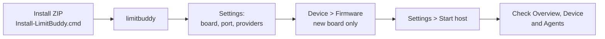

# Quick start

The PC app is the `limitbuddy` terminal command ([install guide](TERMINAL.md)); the graphical app and EXE are retired.

1. Choose and save board, USB port and providers in **Settings**. Nothing is preselected and setup never flashes hardware.
2. **Start host**, then check real USB status in **Overview** / **Device** and observational links in **Agents**.

> [!TIP]
> Claude Code quota needs no extra setup when you are signed in to Claude Code on this PC: the host reads your 5-hour and 7-day quota about every 5 minutes with that login ([details](PROVIDERS.md#claude-code)). The host renews an expiring login through the Claude Code CLI; if the card still says "check login", run `claude auth login` once.

More: [provider setup](PROVIDERS.md) · [development](DEVELOPMENT.md).

## Reading the display

| Element | Meaning |
| --- | --- |
| **Header** | Tightest quota window over all selected AIs, e.g. "29% left / CODEX Week". |
| **Card edge** | Amber or red = a window is low or critical. Faint bar ticks are a 25 / 50 / 75 % scale, not thresholds. |
| **White marker on a bar** | Where an even burn would be by now (window length and reset time). With "left" bars, a fill shorter than the marker means quota is going faster than the window; longer means you are ahead. Hidden when the reset time is unknown. |
| **Ring on the NOVA screen** | The same tightest window with percentage, provider and window name. Hidden without a fresh host and quota reading. |
| **History chart** | Weekday names from the host's local date; observed days show their token count and the newest bar is solid. Unobserved days are a thin tick, never zero. |
