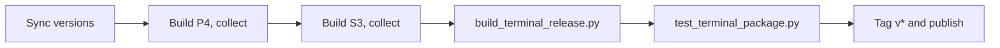

# Release the LimitBuddy terminal

The product is Python source plus verified board firmware. No NOVA application EXE, Qt runtime, PyInstaller or Inno installer is built. Windows releases bundle the official hash-verified Python embeddable runtime and hash-locked wheels (original licenses retained) under `runtime/`; users install offline with `Install-LimitBuddy.cmd`, while source-only setup uses pip. Signing and SmartScreen: [Windows trust](WINDOWS_TRUST.md).



## Local build on Windows

1. Synchronize `FW_VERSION` (`src/config.h`), `HOST_VERSION` (`tools/project_version.py`) and the top `docs/RELEASE_NOTES.md` heading (`# LimitBuddy vVERSION`). The builder rejects a `HOST_VERSION`/`FW_VERSION` mismatch; the workflow also checks the heading and that the tag equals the version.
2. Build both boards sequentially, collecting each image pair before switching (the pinned platforms use different Arduino SDK versions). The collector writes `work/prebuilt/<board-id>/application.bin` and `factory.bin`:

```powershell
.\.venv\Scripts\python.exe -m platformio run -e esp32p4-release
.\.venv\Scripts\python.exe scripts/collect_firmware.py --environment esp32p4-release --output work/prebuilt
.\.venv\Scripts\python.exe -m platformio run -e esp32s3-waveshare-43-release
.\.venv\Scripts\python.exe scripts/collect_firmware.py --environment esp32s3-waveshare-43-release --output work/prebuilt
```

3. Build the package:

```powershell
.\.venv\Scripts\python.exe scripts/build_terminal_release.py --firmware-dir work/prebuilt --windows-runtime
```

Use a fresh output directory each time (default `work/terminal-release`; the builder refuses an existing folder or ZIP) and run from the project's own Git root. The builder exports only tracked reviewed source, rejects private/generated files and linked paths, verifies both application/factory pairs and the version string in the application image, adds the NOVA and ORBIT packs and notices, writes an internal `SHA256SUMS.txt` and produces `nova-vVERSION-windows-x64-terminal.zip`. Without `--windows-runtime` it builds a `terminal-source` archive.

## Test the package

Extract the exact ZIP into a disposable Windows directory:

```powershell
.\.venv\Scripts\python.exe scripts/test_terminal_package.py --package PATH_TO_CLEAN_PACKAGE
```

It runs the real CMD installer without external Python or downloads, then bare `limitbuddy` and `nova` from another folder; verifies no Qt/PyInstaller runtime or unexpected executable; and tests idempotent (un)registration (private settings preserved). It reads no credentials, links no provider hooks and flashes nothing. The test directory contains private setup data: publish only the original clean ZIP.

## Publish

Pushing a `v*` tag starts `.github/workflows/release.yml`:


| Job | What it does |
| --- | --- |
| `prepare` | Skips the build if a release for the tag already exists |
| `firmware` | Builds both targets; requires tag = firmware = host = release-note version; native UI tests on the P4 job; collects images |
| `windows` | Python regressions, builds the x64 terminal ZIP, runs the package test, writes `SHA256SUMS.txt` and current release notes |
| `publish` | Only job with write permission: verifies ZIP vs checksum, attests both, creates a draft; no repository checkout or code execution ([permissions](GITHUB_SECURITY.md)) |

Review and publish the draft explicitly. Never replace immutable published assets. Retiring old EXE releases is a separate owner action; keep source tags and verification evidence.
