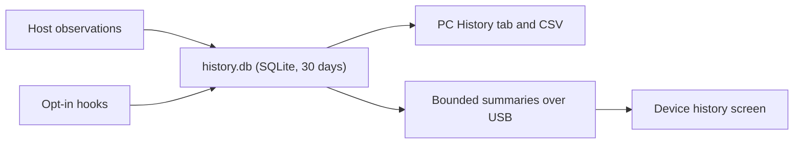

# Connection checklist, history and session states

## Check that your selected AI works

1. Save board, USB port and providers in **Settings > Edit settings**.
2. Open **Agents > Check AI setup**. It separates local activity, account quota, USB delivery and optional session events.
3. Run a normal turn in your client, wait for its local numeric record, press **R**, and check again.

The monitor sends no model request. It reports new counter increases and, with compatible firmware, whether the display acknowledged that source. Readable records only set a baseline, so if the first record is a baseline, run another turn to test an increase. USB connection alone does not prove token delivery. "Quota received" means the running host last reported success, not that every account supports quota.

| Provider | Quota in the checklist |
| --- | --- |
| Codex | Official client/account setup |
| Claude Code | Statusline bridge, else undocumented OAuth fallback ([Providers](PROVIDERS.md#claude-code)) |
| ZCode | Your own Z.AI Coding Plan key |
| Gemini, OpenCode | Local activity only |
| Copilot, Cursor, Antigravity | External numeric bridge |

## Optional local history

Enable **Usage History** in **Settings > Edit settings**, save, start the host. Off by default. **History > 7 / 30 day report** picks the range and shows provider, token, quota and observed-agent metrics; **Export CSV** writes that range. Turning it off keeps existing history and stops new observations.

| Rule | Detail |
| --- | --- |
| Stored | Counter increases and numeric quota snapshots in `tools/activity/history.db`, up to 30 days |
| Never stored | Prompts, conversations, account IDs, credentials |
| Gaps | No observation, not zero usage. Imports and the initial baseline are not new work |
| Quota view/export | Latest 256 observations per AI |
| While display is disconnected | Local token increases still collected; account quota follows the connected polling cycle |
| Estimate needs | 3+ fresh increasing quota samples over 2 min in the same window, collection epoch and reset cycle |
| Invalidates a pace | Decrease, long gap, restart/config change, reset (if the window resets first, the app says so) |
| Failures | Storage/queue failures reported; an unfamiliar database is never replaced |

Estimates are not billing totals or promises about when a provider blocks access. Device screens and agent metrics: [Device history](DEVICE_HISTORY.md).

## Claude Code session events

1. Select Claude Code. Open **Agents > Provider events**, choose Claude Code, leave Remove off, confirm and type `LINK`.
2. Restart Claude Code.

This adds observational command hooks and preserves other hooks and custom statuslines. It is separate from **Link Claude quota** (statusline bridge for subscription windows).

- Terminal and display show **Working**, **Needs you**, **Turn complete**, **Session error** (NOVA and ORBIT). **Turn complete** means a response ended, not that the task finished.
- Only selected providers contribute. Without fresh events, normal token/quota behavior resumes. Running/waiting records expire after 15 min, terminal states after 30 s. Events show the latest session state, not all concurrent tools.
- The hook runs the packaged Python adapter from the extracted NOVA folder (keep the installation together). It keeps only an allowed state, receipt time and hashed session ID, suppresses output, always exits successfully, never approves permissions and opens no network listener. Claude's `disableAllHooks` is preserved and reported, not bypassed.
- **Remove:** run Provider events with Remove enabled; this removes only this installation's hooks and invalidates earlier events.
- Local numeric records stay private under `tools/activity` and are never release assets.

Event support: Claude Code, Codex and ZCode through separate opt-in adapters ([Live provider events](LIVE_PROVIDER_EVENTS.md)); missing/stale events stay unknown, and other providers use recorded token activity. References: [hooks](https://code.claude.com/docs/en/hooks), [hooks guide](https://code.claude.com/docs/en/hooks-guide).
