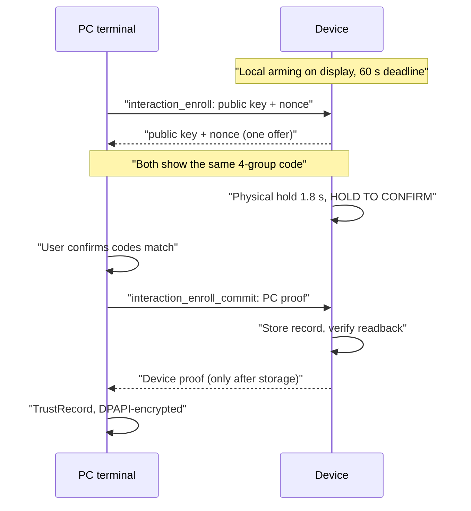

# Authenticated USB interaction foundation

> [!WARNING]
> **Production permission control is disabled.** The generic permission dialog is not initialized in production firmware, and `interactionProtocol` stays 0. No enrolled key, interactive Claude hook or real tool approval was created by these tests. Quota monitoring is independent.

## Enrollment

Ephemeral P-256 ECDH (`tools/interaction_auth.py`); HKDF-SHA256 binds both public keys, nonces, device identity and boot identity. A 64-bit code (four groups of four hex characters) must match on device and PC.

- The PC cannot create a TrustRecord until the device returns the matching proof; the device releases it only after the physical hold, a valid PC proof **and** successful storage.
- Repeated offers, stale UI confirmations, hidden/asleep UI, cancel, malformed input, crypto or storage failure clear the ephemeral key and code. Decline, reboot, timeout or ambiguous commit never retries approval or enables permissions.
- Enrollment does not enable permission opt-in (`enrollmentProtocol` 1, `interactionProtocol` 0). Opt-in is never restored from the record.
- Comparison/confirmation needs a 3-second enrollment-specific channel lease; only valid enrollment status polls renew it, not quota heartbeats. P4 also checks the live CDC connection at the final storage gate. Local arming survives the host-to-setup port handoff.
- Serial task owns crypto/NVS; UI owns all LVGL; bounded queues carry only revisions and physical actions. Awake/visible freshness is rechecked before and after storing.

To run it: MENU > SETTINGS > CONNECT PC on the awake display, tap **CONNECT PC**, then terminal Device tab > **Connect PC** (type `CONNECT`). The PC action pauses/restores only this installation's host and owns the port meanwhile.

## Stored authority

| Side | Storage |
| --- | --- |
| PC (`tools/interaction_trust.py`) | `tools/permission-trust.json`: encrypted with Windows current-user DPAPI, 32-byte entropy derived from the installation path; no plaintext key; atomic writes; excluded from Git and release export |
| Device | One fixed 104-byte versioned blob, NVS namespace `aimtrust`, SHA-256 corruption check, mandatory readback |

Wrong user/installation, invalid records, symlinks and default all-zero keys fail closed. The checksum is not an authenticity claim and does not replace flash protection. Forgetting targets only this key, never a partition or unrelated settings. Same-user trust does not protect a compromised account. No network listener or cloud account.

## Authenticated sessions

`src/interaction/auth_session.h` and the PC SessionHost mutually prove an enrolled key; the transcript binds device, host instance, both nonces, boot identity and device epoch, with separate labeled proofs to prevent reflection.

| Item | Rule |
| --- | --- |
| Handshake deadline | 3 s |
| Session lease | expires after 5 s without valid authenticated traffic |
| Packet auth | HMAC-SHA256 over direction, session, strictly increasing sequence, exact body bytes and length |
| Body | max 1,024 printable ASCII bytes |
| Body types (`usb_interaction.h`) | heartbeat, request, cancel, close only |
| Request | exact ID/nonce/revision/tool/full-hint/expiry; max 25 s lifetime; one pending (cannot be replaced) |
| Replay ledger | 32 entries per session |
| Heartbeat | renews channel lease, never the permission deadline |

Duplicate/noncanonical JSON, booleans as integers, stale packets, overflow, wrong proofs and crypto failures close the interaction channel. No JSON boolean or board-model match establishes authority; registering an adapter is a capability declaration, not trust. The final decision gate consumes an earned envelope once and rechecks the current request; it cannot earn the physical hold.

`tools/usb_interaction.py` uses the existing Panel serial owner (never a second port) and connects the request/decision path to the same-user IPC service. Unavailable, corrupt or expired channels cancel the request and keep the normal Claude fallback; ambiguous decisions are never retried.

## Validation

- Real Python/OpenSSL P-256 ECDH/HKDF enrollment and DPAPI tests; native/Python bidirectional HMAC interoperability (Windows CNG or OpenSSL, warnings are errors, no fake hash callback). Windows RAW_SECRET is converted from little-endian before HKDF ([Microsoft contract](https://learn.microsoft.com/en-us/windows/win32/api/bcrypt/nf-bcrypt-bcryptderivekey)).
- Synthetic request/receipt/denial/cancel through native transport, broker, serial-owner adapter and helper output; replay, reflection, corrupted signature, type confusion, opt-out, deadlines, rollover, empty keys, nonce mismatch, one-time decisions.
- ESP Mbed TLS compiles for both targets. A private P4 benchmark verified known-answer HMAC, hardware-seeded CTR-DRBG, P-256 agreement and HKDF: 2 key generations 11,114 us, 2 agreements 10,080 us, 1 HMAC 81 us (isolated primitives, not permission latency). It uses ephemeral keys, never writes NVS, has no sender, and is excluded from release builds; data in `.ecc/benchmarks/p4-usb-auth-crypto-2026-10-14.json`.

All fixtures are synthetic; none is a physical enrollment or real Claude permission.

## Remaining gates

> [!IMPORTANT]
> No service or hook starts automatically and no production approval is sent until these pass.

1. Physically validate the connected enrollment/setup/storage path.
2. Implement separate Claude permission opt-in, synchronized UI publication/TX final gates and host startup integration.
3. Validate exact packaged programs and real hold/deny/unplug behavior.

References: [Mbed TLS HMAC](https://mbed-tls.readthedocs.io/projects/api/en/v3.6.3/api/file/md_8h/), [ESP entropy](https://docs.espressif.com/projects/esp-idf/en/latest/esp32p4/api-reference/system/random.html), [P-256 ECDH](https://cryptography.io/en/latest/hazmat/primitives/asymmetric/ec/), [DPAPI](https://learn.microsoft.com/en-us/windows/win32/api/dpapi/nf-dpapi-cryptprotectdata).
