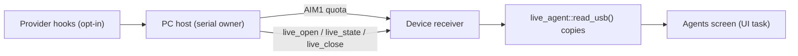
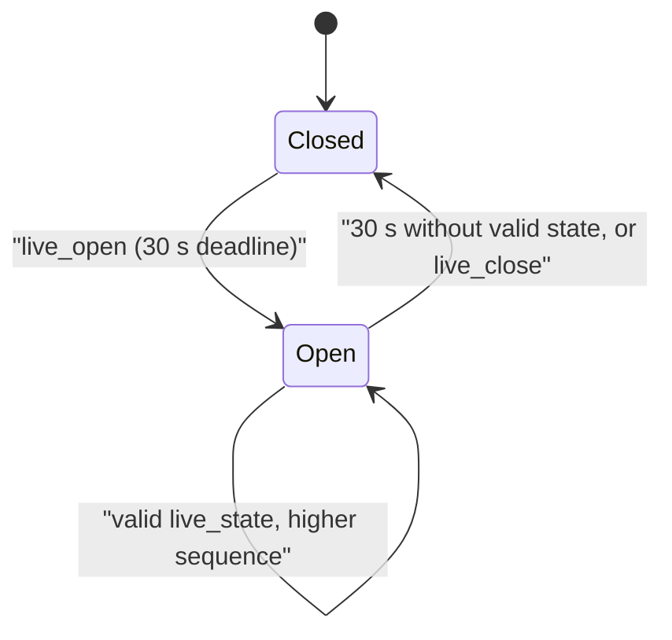

# USB-only live transport

> [!IMPORTANT]
> Bluetooth is permanently excluded (decision 2026-10-13): no BLE advertising, pairing, GATT, Bluetooth host stack or Bluetooth-to-USB relay. C6/controller measurements are historical evidence only.

## Boundaries

- The PC host stays the **sole serial owner**. Quota snapshots keep using AIM1; the live-event domain is separate, versioned and capability-negotiated on the same connection.
- Nothing is added to `aim::Snapshot`; adapters, live state, companion rendering, transport and diagnostics stay separate modules.
- Hosts report only events the provider interface exposes. Missing metadata stays unknown; token increases never imply editing, testing or completed tasks.
- Observational Claude Code hooks never authorize or execute provider tools.



## Status

| Step | State |
| --- | --- |
| 1. Bounded live metadata, identity, lifecycle (no transcripts, commands or tool hints stored) | Implemented |
| 2. Independent envelope, capability negotiation, strict types, deadlines, sequence/epoch correlation | Implemented |
| 3. Synchronized publication, read-only UI consumers (LVGL on UI task only) | Implemented |
| 4. Physical validation: fragmentation, malformed input, backpressure, unplug, reboot, wrong board, stale epochs | **Pending** |
| 5. Provider event sources ([live provider events](LIVE_PROVIDER_EVENTS.md)); [agent screen](LIVE_AGENT_VIEW.md) | Opt-in Codex/Claude/ZCode observers |

## Wire protocol

`get_info` advertises `liveProtocol:1`, `liveMetadata:2`, `liveSummary:1`, `livePermissions:false`. Old firmware is never sent live commands. Commands are bounded JSON lines interleaved with AIM1 (no second serial connection); fields are exactly allowlisted.

```json
{"cmd":"live_open","schema":1,"requestId":1}
{"cmd":"live_state","schema":1,"bootId":17,"epoch":1,"sequence":1,"agents":[{"provider":"claude","id":"opaque_1","state":"TESTING"}]}
{"cmd":"live_close","schema":1,"bootId":17,"epoch":1}
```

Open returns a device-issued epoch and sequence zero. `live_reply` carries type, schema, cmd, ok, bootId, epoch, sequence, `permissions` (always false) and requestId (zero for state/close). Examples use synthetic IDs.

| Limit | Value |
| --- | --- |
| Agents per snapshot | max 8; known provider keys; unique provider/ID pairs |
| Agent ID | 1-64 chars of `A-Z a-z 0-9 _ -`; opaque, never paths or text |
| States (v1) | UNKNOWN, IDLE, THINKING, EDITING, SEARCHING, BUILDING, TESTING, WAITING, FAILED, DONE |
| States (`liveMetadata:2`) | adds WORKING, READING, WRITING, RUNNING, NEEDS_ATTENTION, ERROR, COMPLETED |
| `elapsedSeconds` / `observedAgeSeconds` | 0..604800 / 0..900 (optional, capability 2) |
| Rejected | tool hints, transcripts, provider commands, permission fields, unknown fields, booleans, out-of-bounds values (whole snapshot) |

Legacy three-field entries and FAILED/DONE aliases still work; the host downgrades entries for panels without capability 2. UNKNOWN/IDLE preserve incomplete data instead of inventing activity.

### Summary and names (`liveSummary:1`)

Three optional top-level `live_state` fields, always together; sent only when `get_info` advertises the capability:

| Field | Meaning |
| --- | --- |
| `total` | Sessions observed on the PC, 0-255, at least the number listed |
| `selectedMask`, `linkedMask` | Bit per provider in catalog order: selected / lifecycle-linked |

They let the Agents screen say "8 of 11" or "Not linked: CODEX, CLAUDE". Rows may carry `label` (1-15 ASCII letters, single spaces) and `hue` (0-11) derived from the opaque id by `tools/session_identity.py`, so device and terminal show the same name. A name aids recognition; it is not identity and carries no content.

### Session semantics



- State is a complete replacement (an empty list is valid). Duplicate or older sequences never renew freshness.
- Wrong boot/epoch traffic is rejected without renewing or replacing state. Invalid current-session metadata clears display data atomically.
- Rollover-safe timing. Sequence/epoch exhaustion requires reopening or reboot, never wrapping. A new open resets the sequence; old epochs are never replayed.
- `src/live_agent/usb_live.h` owns the state; the receiver publishes synchronized copies. It does not renew the quota host lease.
- `tools/usb_live.py` uses the existing Panel owner and verifies correlated replies; ambiguous delivery invalidates its session without retry. Old firmware keeps normal quota behavior.

Synthetic Python and strict native C++ tests cover metadata, correlation, stale epochs, expiry, rollover and coexistence with quota. They do not establish physical USB performance or provider compatibility; measure latency, queue pressure and quota coexistence before choosing production scheduling. The live domain carries no trust (see [USB_INTERACTION_AUTH.md](USB_INTERACTION_AUTH.md)).

## Permission integration gate

> [!WARNING]
> Permission controller and dialog are **not enabled in production** ([PERMISSION_UI.md](PERMISSION_UI.md)). A USB cable establishes neither provider authorization nor host identity. Never hardcode `secure=true` for USB.

Approval would require all of: independently verified host session, explicit local opt-in, documented provider decision interface, the exact current prompt, complete visible details and a continuous physical hold. Reconnect, stale data or ambiguous delivery fail closed without replay. Host/device/nonce/revision, freshness, opt-in, visibility and single-use final commit are all checked.

The developer-only path is drawn in [USB_PERMISSION_HELPER.md](USB_PERMISSION_HELPER.md); plan: phase 7 in [COMPANION_V2.md](../plans/COMPANION_V2.md). Contract: [Claude Code PermissionRequest](https://code.claude.com/docs/en/hooks#permissionrequest).
