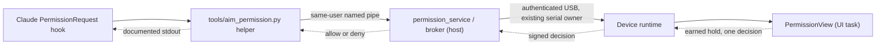

# USB permission implementation status

> [!WARNING]
> **Permissions are not enabled in production.** The normal Claude permission dialog remains the fallback. USB attachment and a local pipe do not authenticate a device approval. Everything below is developer-only until physical validation passes.

## Request path (developer only, disabled)

The host never starts the service in normal operation; the local release gate is false, so no trust file is read, no IPC is opened and no approval is authorized. The observational events hook (`AI-Monitor-Events`) has no approval capability.

## What exists

| Component | Behavior |
| --- | --- |
| `src/interaction/` | Generic request, state machine and controller, independent of ClaudeLiveSnapshot. Native LVGL dialog keeps the 1.8 s continuous hold, complete visible details, cancellation and one-time final commit |
| `tools/aim_permission.py` | Separate PermissionRequest helper. Extracts tool and all canonical arguments, bounded to 320 printable ASCII chars; anything not fully reviewable uses the normal Claude dialog; never truncates before approving |
| Request identity | Random 128-bit ID, 256-bit nonce, revision 1, max 25 s lifetime, exact response correlation. Output is only Claude's documented allow/deny; cannot alter tool input or persistent rules |
| `tools/permission_ipc.py` | Windows named pipes, explicit current-user DACL, remote clients rejected, bounded JSON bytes; no TCP, pickle or shell. Kernel-reported peer PIDs checked against installed host/helper paths |
| `tools/permission_broker.py` | One request; checks local opt-in, authenticated device, host instance, session, nonce, revision, deadline. Disconnect, context change and ambiguous decisions consume/cancel authority. Replay ledger stores IDs/nonces only; exhaustion rejects requests until a new host instance |
| `tools/permission_service.py` | Optional local IPC service; rechecks authority right before returning a decision. Endpoint holds only PID and instance ID; prompt arguments never reach disk or logs |
| `tools/permission_runtime.py` | Explicit attachment to the existing Panel owner; host-instance replay protection across reconnects. Needs user opt-in **and** a separate locally constructed validation gate. Disabled attachment never reads trust or opens IPC. Failed/ambiguous startup is not retried; incomplete service shutdown blocks replacement until host restart |
| `Panel.attach_permission_runtime` | Event routing, pumping, close hooks connected; normal startup makes an inactive coordinator. Best-effort authenticated close cancels device authority on shutdown (no await/retry); disconnect relies on lease expiry |
| `tools/claude_permission_setup.py` | Hook setup; still expects the retired `AI-Monitor-Permission.exe`, not exposed in the terminal, not packaged |

## Device runtime (developer environment `esp32p4-permission-integration`)

| Piece | Rule |
| --- | --- |
| `permission_delivery.h` | Only a real UI-owner commit admits a decision; one-shot. Final consumption checks the current request and a UI observation younger than 100 ms |
| `permission_serial.h` | Signs only when normal USB output is empty and a whole packet fits (max 768 bytes); rechecks connection, lifetime and UI freshness after signing and capacity checks. No signed decision queues behind ordinary output; short/ambiguous writes consume authority, invalidate the session, are never retried |
| `permission_runtime_esp.*` | Joins the serial task and a recursive task mutex; no LVGL on that task. Local cancel uses an atomic revocation latch before waiting for the mutex. Opt-in is a versioned atomic latest-value request (an older enable cannot replace a newer disable). Consent starts off, is not saved, has no wire/USB field and cannot wrap. Trust loads on the serial task only after local opt-in |
| `src/ui_permission.cpp` | Owns PermissionView on the UI task; rechecks awake/visible; offers only an earned, committed envelope. Failed publication reads revoke before hiding |

Normal P4/S3 builds keep `interactionProtocol` 0 and create no permission overlay; the developer environment is not a release target. Native tests (hold/deny through the gate, changed request, hidden UI, trust loss, expiry, rollover, forged envelopes) do not establish physical approval safety.

## Setup and removal

- The production terminal exposes **no** permission preference or hook action; **Settings > Edit settings** omits `usb_permissions`. There is no supported helper to install or remove.
- Enrollment-only path: **MENU > SETTINGS > CONNECT PC** on the display, then terminal Device tab > **Connect PC**; compare every code group. It enrolls a key on supported developer firmware and does not enable permissions ([details](USB_INTERACTION_AUTH.md)).
- Developer firmware has a separate permission toggle on the same page; consent resets on every reboot and normal firmware shows a disabled preview. Each request still needs a new 1.8 s hold (a finger already down cannot start approval). PC preferences cannot open the local validation gate.
- Fallback: unavailable host, invalid request or timeout gives empty stdout and exit 0, so Claude keeps its normal flow. Never an automatic allow.

## Remaining production gates

1. Physically validate enrollment (code comparison, NVS record/readback, DPAPI). Never take `trustedChannel` from a JSON boolean or matching board model.
2. Physically validate the developer adapter: task synchronization, UI publication, immediate serial write, authenticated decisions, disconnect cancellation. Quota/live state stay in separate structures.
3. Validate explicit desktop/device opt-in and Claude PermissionRequest setup with packaged programs.
4. Verify packaged helper/server, hold/drag/touch failure, expiry and unplug; confirm the real hook contract without synthetic evidence.

No interactive hook is installed and no real tool permission has been approved. See [USB_INTERACTION_AUTH.md](USB_INTERACTION_AUTH.md), [PERMISSION_UI.md](PERMISSION_UI.md).

References: [Claude hook contract](https://code.claude.com/docs/en/hooks#permissionrequest), [named pipe security](https://learn.microsoft.com/en-us/windows/win32/ipc/named-pipe-security-and-access-rights).
