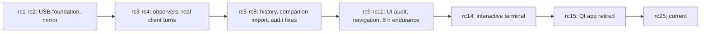

# v2 status

## Current state (v1.19.1-rc25)

| Topic | State |
| --- | --- |
| Distribution | LimitBuddy terminal. `nova-<version>-windows-x64-terminal.zip` = source + verified private Python runtime + hash-locked dependencies (offline Windows setup); `nova-<version>-terminal-source.zip` = source only. Run `Install-LimitBuddy.cmd`, open a new terminal, type `limitbuddy`. Graphical app and NOVA EXE retired in rc15. See [TERMINAL.md](TERMINAL.md), [RELEASE_NOTES.md](RELEASE_NOTES.md). |
| Companions | NOVA, ORBIT, CLAUDE on both boards; WRAITH and GLITCH on P4 only (`src/companion_features.h`). On S3 a stored WRAITH/GLITCH choice shows NOVA. |
| Unchanged gates | Physical permission approval disabled; Bluetooth permanently excluded; S3 has no physical hardware validation. |

> [!WARNING]
> Everything below is dated, version-specific evidence from rc1 to rc14. Mentions of desktop executables, the Qt app, tabs and the per-user installer describe those candidates, not the current distribution. Newer candidates need their own evidence.

## Candidate history (rc14 and earlier)

Source, PC executables and normal firmware shared each version. None claims every physical/security gate passed.

| Candidate | What changed / was shown |
| --- | --- |
| rc14 | Interactive terminal: full-color quota bars, original NOVA cell art, observed sessions, history trends, shared desktop operations; fixes monochrome startup, short-window layouts, invalid drafts. Full Windows package uses its console helper's bundled runtime; source-only installs prepare a Python env. No sixth executable. See [TERMINAL.md](TERMINAL.md). |
| rc11 | Fixed primary navigation; observed agent sessions separated from quota providers (short session ID; empty acknowledged feed differs from unavailable feed). Connected-runtime endurance: 28,800 s, 5,737 samples, 0 failed. Version-specific: not an rc14 soak, nor proof of physical approval, S3 touch or unplug/suspend. |
| rc10 | UI action/state audit: quota errors beside session signals, expiring agent presentation, local-calendar daily history, explicit history clearing, bounded diagnostics, installation-scoped upgrade/uninstall, companion activation needs saved board and port. |
| rc9 | Alternate Claude profile paths (one shared resolver), config-read retry with backoff, scalar NVS read/save confirmation in the atomic load gate. |
| rc8 | Eight logic defects: stale history consent renewal, recovery-copy ACLs, partial saves after revocation failure, lease-renewal event loss, task-list identity collisions, invented zero outcomes after cancel, replacement during pending pack adoption, partial NVS reads. Mixed legacy/new task identities stay unknown. |
| rc7 | Nine audit defects: sensitive-file ACLs/backups, stop/crash history consent, midnight outcomes, dormant-journal retention, elapsed agent/token age, uncertain pack activation, quota fallback text, EVENTS back navigation. |
| rc6 | Data-only companion import, bounded PC library, USB restore into two preallocated P4 RAM banks; only complete hash-verified packs adopted; interruptions keep the old pack; no S3 packs. |
| rc5 | ZCode lifecycle events kept in opt-in history; History tab shows/exports daily sessions, active seconds, completed/failed turns (7/30 days). 529 Python tests, changed-module coverage 93%. Hooks are not confirmed task outcomes. |
| rc4 | Windows Codex hooks need PowerShell's call operator before the quoted observer (older wrapper migrated, custom hooks and trust review untouched). Real Codex and ZCode turns delivered WORKING/COMPLETED over live USB; Claude Code with Z.AI GLM passed a reply and a Read-tool round trip. Tested paths only; GLM gives no native Claude models or quotas. |
| rc3 | ZCode lifecycle observer, independent event reader, agent USB ack/error status, hook-definition checks, legacy Codex wrapper migration. A live-packet ack does not prove client delivery. |
| rc2 | Post-handshake USB cleanup, screen-capture response ownership and correlation, persistent capture errors, long status visibility. Physical results below are rc1's. |

Claude client task counts come from verified successful TaskCreate/TaskUpdate post-tool results, separate from turns and pre-veto hooks. Unknown provider/failure metrics stay unknown; PC daily table/CSV and schema-3 P4 history carry only counts; old schemas still supported.

## Area status

| Area | Implemented | Validation / remaining gate |
| --- | --- | --- |
| USB permissions | UI-to-serial final commit, authenticated developer adapter, explicit PC/display opt-in, separate Claude setup/removal | Native real-crypto/LVGL tests pass. Production disabled pending physical enrollment/hold/deny/unplug/provider tests. |
| AI monitoring | Codex/ZCode quota + recorded token activity; Codex/Claude/ZCode observational integrations | rc4 host: Codex/ZCode quota ready on P4; real local turns and live USB delivery passed for all three observers; Claude Code with GLM is activity-only for Claude quota; local Codex hooks do not cover cloud-orchestrated Work. |
| History | Opt-in bounded lifecycle/task journal, migration, sessions/active time/turns, Claude task transitions, Today/24h/7d, desktop daily summary/CSV | Native/SQLite/USB/desktop tests pass. Waiting/gaps excluded, parallel activity unioned, no task text or invented results. Task completion is a client report, not proof tests passed. |
| Companions | Animation schema 2, PC import/library, staged USB transfer, UI activation, LZ4 cache | Native parsing/player/transfer/LVGL tests and both board builds pass; P4 preallocated active/staging banks, PC restores selection; no display FS formatting or microSD. Physical validation is distinct. |
| Device mirror | Real device RGB565 capture, normal overlays, existing USB owner, explicit PC viewer | Physical P4 capture 3.094 s direct, 4.922 s via installed host; PSRAM free returned to same value. Protected screens excluded; no touch/approval. |
| Packaging (rc4) | Both board images, five rebuilt Windows executables, checksummed portable ZIP, per-user installer | Installer upgrade/startup passed on the existing PC, settings unchanged; a read-only CI workflow can verify clean-profile install/upgrade/uninstall without publishing. |

rc4 evidence: 521 Python tests plus all native checks; both firmwares and five executables rebuilt from source; P4 app-only update backed up and digest-verified (NVS, bootloader, partition table preserved); package contents, manifests, installer/ZIP SHA256 and CRC verified; installed host reconnected to COM6 with live USB after its login task was updated (tests the scheduled action, not a full reboot). No S3 validation or long soak.

> [!WARNING]
> Windows binaries are unsigned: no usable code-signing certificate was found. Compiler checksums and Microsoft file review are not a publisher signature. Do not disable SmartScreen, install a fake trusted root or call unsigned artifacts signed.

Later v2 items stay separate: confirmed build/test results, other providers' task outcomes, Git status, audio, configurable layouts. Bluetooth stays excluded.

Evidence and contracts: [validation log](V2_VALIDATION.md), [permissions](USB_PERMISSION_HELPER.md), [history](DEVICE_HISTORY.md), [animations](COMPANION_ANIMATIONS.md), [mirror](DEVICE_MIRROR.md).
