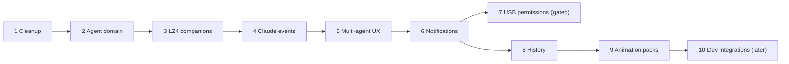
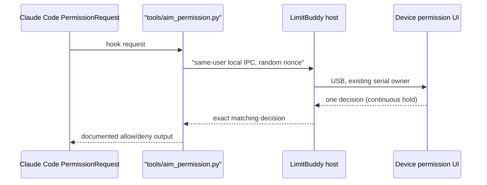

# LimitBuddy v2: physical AI agent companion and monitor

> [!NOTE]
> Planning document; phase checkpoints describe the state when written. Current status: [V2_STATUS](../docs/V2_STATUS.md), [RELEASE_NOTES](../docs/RELEASE_NOTES.md). Invariants and phase rules still apply. The graphical desktop app and EXE helpers in older checkpoints were retired in rc15 (terminal distribution).

The updated repository review supersedes the earlier construction order. Inspect current main and the working tree first; preserve verified work and the mature USB/AIM1 system. English code, UI and docs. A local build or mock does not establish push/release readiness or complete integration; physical exit gates do.

## Invariants

- **Transport:** only the PC host's USB/AIM1 connection. No second production transport, no C6 runtime dependency, no wireless, network listener, cloud account, web dashboard, camera, voice assistant, transcripts or remote shell. Historical C6 measurements stay optional developer diagnostics (chip, host/slave versions, earlier controller RPC); C6 failure cannot affect features.
- **Separation:** quota/provider views, token activity, live agents, permissions, companion rendering, history and USB transport keep separate state even when sharing USB. `aim::Snapshot` = quota/views, token activity, host health, refresh. Session counts move to `agent::Snapshot` before agent features grow. Legacy `ClaudeLiveProto` stays tested reference code; do not expand it or depend on it.
- **Truth:** documented/reviewed sources only. Tokens do not establish a phase or start time. Unsupported states, gaps and missing metrics stay unknown; no invented percentages or billing.
- **Ownership and bounds:** LVGL/backlight/NVS are UI-task owned. Buffers, queues, messages, parsers, manifests and transfers have strict type, size and timeout limits. No credentials, prompts or transcripts in Git, history or logs.
- **Tests:** each major subsystem gets synthetic/native tests before physical integration.

## Verified foundations (reuse)

- USB/AIM1, quota/token tracking and PC history exist. Claude observational hooks exist; Codex/Claude lifecycle adapters, the read-only USB metadata channel and the agent/provider screen have synthetic/native validation (real client compatibility is a separate gate). Provider-status rows are not fabricated agents.
- NOVA/ORBIT union-alpha cropping saved 23.8%. P4 validated LZ4 over twelve poses (~520 KB), the PSRAM cache and PPA rotation. Generic renderer and cache ownership/fallback exist. Do not repeat codec research; built-ins stay the fallback.
- Permission controller/UI have native-tested fixed controls, 1.8 s continuous hold, drag/read-failure cancel, full visibility and prompt identity checks, single-use decisions and final commit gates. Preserve them. Real permission transmission stays disabled until phase 7 is validated.
- Dated evidence: [V2_VALIDATION](../docs/V2_VALIDATION.md). Earlier main CI success does not prove local changes pass CI.

## Phase status

| # | Phase | Status at last checkpoint |
| --- | --- | --- |
| 1 | Roadmap cleanup (USB-only architecture) | Done; obsolete radio plans removed; C6 results are developer evidence only |
| 2 | Agent domain cleanup | Implemented; `aim::Snapshot` -> `agent::Snapshot` split |
| 3 | Production LZ4 companions | Implemented and measured on P4; see [P4 benchmarks](../docs/P4_HARDWARE_BENCHMARKS.md) |
| 4 | Documented Claude events and timers | Observational hooks, bounded task events |
| 5 | Multi-agent UX, companion reactions | Agents screen and event-driven home |
| 6 | Notifications and timeline | Bounded, deduplicated, expiring events |
| 7 | USB permission control | Developer-only; production disabled pending physical gates |
| 8 | Device history and daily summary | Today/24h/7d implemented and installed on P4 |
| 9 | Versioned animation packs | Schema 2, PC import, dual-bank P4 staging implemented; physical evidence separate |
| 10 | Developer integrations | Later; PPA lower priority |

Order is the plan's construction order, not a validation order; see the status column and gates.

## Phase rules

1. **Cleanup:** USB-only architecture everywhere; no new radio bring-up; delete obsolete plans rather than leaving them behind a misleading checkpoint.
2. **Agent domain:** session counts/status live in `agent::Snapshot` (own publication, revision, expiry); `session_activity` stays a compatibility wire command. States: IDLE, WORKING, THINKING, READING, SEARCHING, EDITING, WRITING, RUNNING, BUILDING, TESTING, WAITING, NEEDS_ATTENTION, ERROR, COMPLETED, UNKNOWN. Detailed phases need explicit trusted-source events; legacy names are mapped, never relabeled as evidence.
3. **LZ4 companions:** verified compressed built-ins via PSRAM cache, `CompanionRenderer`, LVGL; safe fallback chain; boot-time bounded pools. Measure built firmware size, free app space, boot time, heaps, frame-switch latency; a codec estimate is not a firmware saving. microSD is not a priority.
4. **Claude events:** add PostToolUseFailure, SubagentStart/Stop, TaskCreated/Completed, PermissionDenied, TeammateIdle; normalize without keeping text/arguments/results. Observational hooks never authorize tools, modify inputs, run commands or return model context. Durations only from reliable events; a stopped turn is not success; no guessed progress percentages.
5. **Multi-agent UX:** per-agent state and timers, fixed navigation, honest source readiness (provider-status fallback is not a live session). Event-driven home; no card clutter or unsupported classification.
6. **Notifications:** bounded, deduplicated, expiring events (attention, completion, failures, quota, disconnect, pack/storage errors) with type, source, timestamp, severity, short safe text, read state. Timeline is structured events, never conversation history; no persisted permission hints.
8. **History:** Today/24h/7d implemented and installed on P4; lifecycle journal adds observed sessions, active time and turns (waiting/gaps excluded, overlaps unioned; rc6 adds successful Claude post-tool task transitions). Opt-in; never transfers SQLite; local preferences stay out of public source. [Device history](../docs/DEVICE_HISTORY.md).
9. **Animation packs:** schema 2 + allocation-free playback, PC import/storage, dual-bank P4 RAM staging with host restoration (interrupted replacement keeps old pack) implemented. Staging, atomic activation, recovery required; microSD optional. [Animation format](../docs/COMPANION_ANIMATIONS.md).
10. **Developer integrations (later):** structured build/test results, project/branch/last-commit status, approve/stop/retry only via explicit supported integrations; no terminal scraping, device Git client, remote shell or inferred test results. Revisit PPA after runtime rendering load grows; CPU path meanwhile.

## Phase 7: Claude permission control over USB

Checkpoint: generic interaction types, dedicated helper, current-user Windows IPC, bounded host broker/service, Panel-owner lifecycle hooks, host-instance replay protection, authenticated transport, PC ECDH enrollment with DPAPI, device enrollment and key persistence are implemented with synthetic/native tests. A developer-only P4 target connects the UI-to-serial handoff (needs a real `PermissionView` commit and fresh local visibility) with atomic cancellation and no opt-in at boot. Production startup and normal builds stay disabled; physical enrollment, provider validation, final TX gates and opt-in remain required. See [implementation status](../docs/USB_PERMISSION_HELPER.md) and [authentication evidence](../docs/USB_INTERACTION_AUTH.md).

- The event observer stays observational; the permission helper is separate with explicit setup and never shares interactive authority with it.
- The helper accepts one strictly bounded request, extracts only transient ID/tool/hint, sends to the running host, waits for one exact matching decision, returns the hook response and exits. No sockets, arbitrary file access, shell, config changes, persistence, auto-approval or ambiguous approval retry. If unavailable/expired, prefer normal Claude permission handling when its contract allows; never auto-allow. Verify the real hook contract before implementing fallback/output.
- Generic `PermissionRequest`, `InteractionSnapshot`, `PermissionContext`, `PermissionDecision`, independent of `ClaudeLiveSnapshot`. Trusted context: connection, opt-in, trustedChannel, visibility, awake, demo. USB attachment alone is not host trust.
- Local IPC: per-user restriction, correct host instance, bounded fixed messages, nonce correlation, deadline, one response, no TCP listener or arbitrary operations.
- At transmission recheck device/session, opt-in, current request ID/revision, freshness, visible complete details, earned continuous hold and single-use commit. Disconnect, request change, stale state, hidden UI or trust loss cancels. Test synthetically before harmless real approval/denial and unplug-during-hold.

## Validation and hardware gates

- P4 is JC4880P443C_I_W_Y on COM6; **COM4 belongs to another project and must not be accessed**. No physical S3 is available.
- Production diagnostics keep firmware/app/free partition, heap/largest block, PSRAM/largest block, display buffers, uptime, touch/host and future cache health.
- Preserve private settings, NVS and firmware rollback backups.
- Release gates: fresh terminal-package install, real provider events, physical touch/USB tests, memory/latency, soak, fresh-PC checks. Windows signing is unresolved; do not bypass protection.

## Next work at rc14 (historical)

Enrollment (arming, matching physical UI revision, PC proof, stored key before acknowledgment), separate permission opt-in and developer publication/transmission gates are implemented. Next: physically validate enrollment and the final exchange; keep production permissions disabled until packaged programs and physical provider/unplug tests pass. The user confirmed Codex hook trust review, but real hook delivery still needs observation; neither that nor a saved marker proves lifecycle exchange.

References: docs/USB_LIVE_TRANSPORT.md, docs/LIVE_PROVIDER_EVENTS.md, docs/LIVE_AGENT_VIEW.md, docs/COMPANION_RUNTIME_FORMAT.md, docs/P4_HARDWARE_BENCHMARKS.md, docs/PERMISSION_UI.md.
